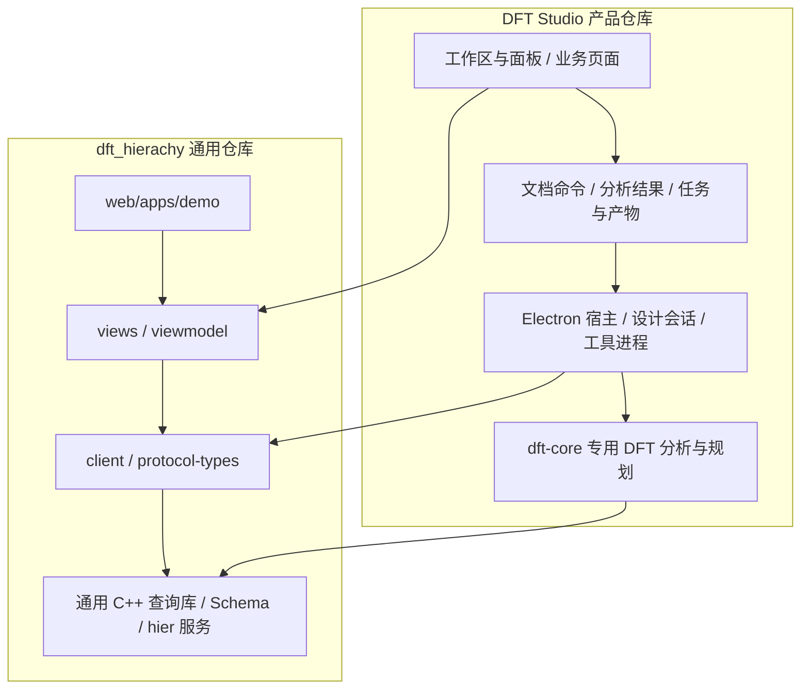

# DFT Studio 实现参考项目与产品架构调研报告

日期：2026-10-12。执行者：Agent D。任务：D-STUDIO-02。

本文回答“Studio 应参考哪些项目、分别参考什么、怎样转成实现”。它是研究建议，不替代 [DESIGN](../DESIGN.md)，不宣布启动完整 Studio 重构。旧十工作区调用链、组件接口问题和第一次包消费实验见 [M5/M6 深度报告](M5-M6-client-research.md)；本报告在该证据基础上补足完整产品、任务与工程资源方向。

## 1. 结论与参考优先级

**用户提供的候选名单可以采用，但应按要解决的问题分配参考对象。DFT Studio 最值得组合研究的是 ECOS Studio、Theia、HAL、OpenROAD、SiliconCompiler、LibreLane，以及规划编辑方向的 Kactus2。**

| 需要解决的问题 | 第一参考 | 辅助参考 | 对 DFT Studio 的具体产出 |
|---|---|---|---|
| 完整产品的工程入口、工作区、资源、运行状态 | ECOS Studio | 旧 dft-suite | 工程打开流程、工作区组织、任务与产物导航 |
| 面板创建、唯一实例、激活、关闭与文档生命周期 | Theia | ECOS Studio | 小型宿主面板/命令服务，面板和模型分开拥有 |
| 网表浏览、局部图、属性与选择联动 | HAL | OpenROAD、Verdi 公开资料 | 统一语义选择、多个图文档、对象检查与导航历史 |
| 违例/分析结果到对象、图和属性的定位 | OpenROAD | HAL、旧 DRC/Clock 页面 | 结果行携带可定位对象；选择、悬浮、固定标注分别管理 |
| 长任务、日志、指标、产物及多次运行比较 | SiliconCompiler | ECOS Studio、ECC | 任务记录、输入身份、结果清单、失败诊断与重新运行 |
| 分步骤执行、输入输出快照、可复现失败 | LibreLane | ECC、Hammer、ORFS | 保存每次运行的配置/版本/输入/输出依据，定义重跑失效规则 |
| 规划对象、连线编辑、撤销重做、业务校验 | Kactus2 | 旧 Genconn/Specgen/Scan/MBIST | 文档命令与视图投影一致，规划对象独立于 RTL 对象 |
| 通用树、图布局与渲染 | 既定 React/TreeModel/SVG/ELK | Sprotty、d3-hwschematic、react-arborist | 延续当前 M5/M6 方案，完善公共契约和外部消费 |

这里的“参考”大部分指借鉴职责划分和可观察行为。**不建议将整个 ECOS Studio、Theia 或物理设计 flow 作为 DFT Studio 的必需底座。** 现阶段证据支持继续 Electron + React、复用当前仓库的 SDK 和组件。参考对象各自解决不同问题，没有一个项目同时提供我们的 RTL 位段语义、DFT 规划、业务文档和十个工作区。[ECOS 技术栈][ECOS-GUI]、[Theia 组件组合](https://theia-ide.org/docs/composing_applications/)、[既有组件比较](M5-M6-client-research.md#4-对标源码比较采用什么验证到了哪里)

## 2. 用户提供材料的核实与修正

| 原材料中的说法 | 核查结论 | 使用这条信息时的边界 |
|---|---|---|
| ECOS Studio 分 GUI、IP、ECC、PDK 四部分 | 根 README 的划分成立，gitlink 也能对应 ECC、retroSoC、ICS55 | 这是产品集成关系；各仓库最新提交不等于 Studio 所锁定的组合。[根说明][ECOS-README] |
| Frontend Design 仍为 Coming Soon | **当前指南已改为 Experimental**，描述 RTL review、elaboration、lint、simulation、source editor、waveform；IP Catalog/Benchmarks 仍是占位 | 实验性功能的描述不能升级为成熟可用性结论，本轮未跑这些功能。[指南][ECOS-GUIDE] |
| 新建 Backend Workspace 有六步 | 当前指南仍是 Project Setup → Basic Info → Flow Setup → Design Files → PDK Config → Spec Setting | 这适合物理设计项目；DFT 浏览入口不应强制要求 PDK、die area 或 CTS 配置。[向导][ECOS-WIZARD] |
| AppImage 已包含整套工具，直接体验即可 | Linux x86_64 AppImage 的入口成立；**GUI 开发说明明确 packaged build 不内嵌 ECC，而由 CLI installer 获取固定 bundle** | “集成”不等于“所有资源均内置”；当前 macOS 工作区不能直接运行 Linux AppImage。[发行说明][ECOS-README]、[运行时获取][ECOS-GUI] |
| ECC-Tools README 仍写 iEDA | 成立。ECC 的 `.gitmodules` 明确依赖 `openecos-projects/ecc-tools`；iEDA 和 ECC-Tools 此次固定到不同提交 | 可说明代码/工具体系的关联，不能由同名 README 推出两个仓库内容相同、API 可互换或已经合并。[ECC 子模块][ECC-MODULES]、[ECC-Tools][TOOLS-README] |
| OpenROAD 主要参考原生物理设计 GUI | 原生 GUI 仍有价值；**当前还存在 Web Viewer**，公开说明为服务器生成 PNG tiles，经 WebSocket 传递 | 大版图瓦片化与 RTL 逻辑图是不同绘图问题，不据此替换 M6 的 React/SVG。[Web Viewer][OR-WEB] |
| LibreLane 是 OpenLane 2 的后续、由 FOSSi 维护 | 官方 FAQ 确认该来源和维护关系；当前提供 Classic 与 Chip 参考 flow | 它是可编程实现 flow 基础设施，不能按“完整 IDE”打勾。[官方 FAQ](https://librelane.readthedocs.io/en/latest/faq.html)、[项目说明][LL-README] |
| SiliconCompiler 有 Web Dashboard | 成立；源码可见 Streamlit 服务进程、manifest 更新、指标/节点/文件/运行比较视图 | Dashboard 的任务节点不是电路图节点，也不提供我们的 ObjectRef/位段语义。[实现][SC-WEB]、[页面组成][SC-TABS] |
| ICS55 是可用的开放 PDK | 仓库确实公开相应资源；当前 README 的 Status 仍标注 preview，并说明验证/生产使用限制 | 可作为资源目录和宏库样例；不能把“开源”直接解释为量产成熟度。[当前 Status][PDK-README] |
| 没有找到独立官方 B 站教程 | 本轮没有穷尽视频平台，不能据此证明不存在 | 实现证据以固定源码和官方指南为主；教程只能辅助理解操作 |

“Vivado/Innovus 式”“GUI 很强”“最成熟”等表述可以帮助描述产品方向，但不是本轮实测结论。报告不使用简单的 RTL→GDS/GUI 勾选表来推导 DFT Studio 的选型。

## 3. 候选项目全表

“源码”表示读过与结论相关的实现，未表示审计整个仓库；“前轮源码”沿用固定证据；“资料”只支持项目定位。优先级针对 DFT Studio，不是对项目质量排名。

| 项目与官方入口 | 定位 | 本轮参考级别 | 值得学习 | 不应据此承担的任务 |
|---|---|---|---|---|
| [ECOS Studio](https://github.com/openecos-projects/ecos-studio) | 芯片设计产品与 Electron 工作台 | **首要；源码 + 局部运行** | 工程/工作区、运行生命周期、资源获取、结果与日志 | 直接替代已有 React 组件和 DFT 语义 |
| [Theia](https://github.com/eclipse-theia/theia) | 可组合 IDE 平台 | **首要；前轮源码** | 面板、命令、文档关闭、平台分层 | 为固定 demo 先引入完整 IDE 平台 |
| [HAL](https://github.com/emsec/hal) | 网表分析与交互 GUI | **首要；前轮源码** | 语义选择、局部图上下文、属性联动 | 推断 RTL 位段、快照或分页契约 |
| [OpenROAD](https://github.com/The-OpenROAD-Project/OpenROAD) | 物理设计应用、原生/Web 视图 | **首要；源码** | Inspector、DRC/timing 结果定位、领域对象与绘图分离 | 直接用几何图替代逻辑依赖图 |
| [SiliconCompiler](https://github.com/siliconcompiler/siliconcompiler) | 硬件 build system 与 Dashboard | **首要；源码** | run/manifest/metric/artifact 的联系、多次运行比较 | 替代交互式电路编辑与设计查询 SDK |
| [LibreLane](https://github.com/librelane/librelane) | ASIC flow 基础设施 | **首要；源码** | step 输入输出、不可变状态、失败复现、阶段恢复 | 把全 RTL→GDS 纳入 DFT Studio 首版 |
| [Kactus2](https://github.com/kactus2/kactus2dev) | IP-XACT 硬件设计与编辑 | **规划编辑首要；前轮源码** | 文档与图同步的命令、undo/redo、端口约束 | 复制为本项目的文档格式或通用图模型 |
| [ECC](https://github.com/openecos-projects/ecc) | ECOS 后端编排/工作区运行时 | **重点配套；源码** | operation、workspace revision、幂等命令、rerun | 替换现有通用 C++ 内核或专用 DFT 分析 |
| [Hammer](https://github.com/ucb-bar/hammer) | 可移植 VLSI flow 框架 | **按需；选定源码** | 工具/工艺/项目配置分层、步骤 hook | 第一版就建立任意插件/远程调度平台 |
| [OpenROAD-flow-scripts](https://github.com/The-OpenROAD-Project/OpenROAD-flow-scripts) | OpenROAD 参考集成 flow | **按需；Makefile/资料** | 阶段目标、运行目录、工具配置与可重跑入口 | 另找一套工作台或复制大型 Make flow |
| [iEDA](https://github.com/OSCC-Project/iEDA) | Netlist→GDS 工具与基础设施 | **后端选读；资料** | 工具接入、物理分析产物 | 作为 Studio 面板生命周期的主要参考 |
| [ECC-Tools](https://github.com/openecos-projects/ecc-tools) | ECC 所用的物理设计工具组成 | **后端选读；资料/依赖关系** | 工具版本与产物接口 | 因沿用 iEDA README 而视为完全相同版本 |
| [Qflow](https://github.com/RTimothyEdwards/qflow) | 脚本化数字 ASIC flow | **补充；资料** | 工具路径、技术配置与工作目录分离 | 再投入同等时间研究另一套客户端壳 |
| [Coriolis](https://github.com/lip6/coriolis) | Hurricane 数据库、布局布线、cgt/Python | **补充；资料** | 原生 EDA 的数据库与脚本接口 | 直接比较成端到端 RTL 综合或 DFT IDE |
| [XiangShan](https://github.com/OpenXiangShan/XiangShan) | Chisel/Scala RISC-V 处理器 | **测试设计；资料** | 将来用生成 HDL 评估大层级浏览 | 用 CPU 仓库决定前端组件技术栈 |
| [retroSoC](https://github.com/retroSoC/retroSoC) | 可定制 SoC/ASIC 设计 | **测试设计；资料** | 中小设计、blackbox/macro、资源样例 | 把 SoC 生成工具当 GUI 框架 |
| [ICsprout55 PDK](https://github.com/openecos-projects/icsprout55-pdk) | 工艺、标准单元与 IP 资源 | **资源样例；资料** | 库目录、资源身份与可用性说明 | 把 PDK 作为 M5 树浏览前置条件 |
| [Sprotty](https://github.com/eclipse-sprotty/sprotty) | 图模型/渲染框架 | **通用图参考；前轮源码** | 模型、布局、视图分离 | 未验证便改用整套 DI/图框架 |
| [ELK JS](https://github.com/kieler/elkjs) | 自动布局 | **既定依赖；前轮源码/局部实验** | 布局输入输出与 Worker 接口 | 替宿主完成过期结果、取消和 Promise 清理 |
| [d3-hwschematic](https://github.com/Nic30/d3-hwschematic) | 硬件原理图显示 | **局部交互；前轮源码/实验** | 网络高亮、显示边到原网络映射 | 用绘图转换推导真实 RTL 依赖 |
| [react-arborist](https://github.com/jameskerr/react-arborist) | React 树组件 | **交互参考；前轮源码** | 键盘、焦点、ARIA | 替代当前远端查询/分页 TreeModel |

iEDA/ECC-Tools 的项目定位见各自 README；Qflow/Coriolis/XiangShan/retroSoC/PDK 的定位也只据官方说明，没有对它们执行设计或算法测试。[iEDA][IEDA-README]、[Qflow][QFLOW-README]、[Coriolis][CORIOLIS-README]、[XiangShan][XS-README]、[retroSoC][RETRO-README]

## 4. 首要项目的实现证据与采用建议

### 4.1 ECOS Studio：学习产品组织和运行生命周期

固定 `01ba484714431ca3819801692e0b91a9c6599bc4`。GUI 是 **Electron + Vue 3 + TypeScript**，使用 Pinia、PrimeVue、Monaco 等；并非 React。`apps/desktop-electron`、`apps/renderer`、`packages/shared` 的划分能作为进程/契约边界参考，不要求复刻它的框架组合。[GUI 说明][ECOS-GUI]、[renderer 依赖][ECOS-PACKAGE]

实际核对的调用关系：

```text
useFlowRunner / flow.ts
  → desktopApi.productCommands.execute(workspace.run / workspace.runStep)
  → Electron preload 与 main 注册
  → productCommandService：校验输入、确认 workspace handle 所属、检查可修改状态
  → EccRuntimeService / 对应 workspace runtime
  → operation.start_flow / operation.start_step → ECC sidecar RPC
  → operation 事件、运行状态投影、页面资源更新
```

`flow.ts:184` 起有统一运行命令；`productCommandService.ts:169` 分派到 startFlowOperation/startStepOperation，`:267` 起检查幂等键和预期工作区修订；sidecar 以独立进程运行 `rpc serve --stdio`。ECC 子模块的 stdio 服务使用 Content-Length 分帧的 JSON-RPC，**与本项目 M4 的 NDJSON 协议不同**，这里只借鉴职责。[UI 命令][ECOS-FLOW]、[主进程命令][ECOS-COMMAND]、[sidecar][ECOS-SIDECAR]、[固定 ECC 分帧][ECC-STDIO]、[workspace runtime][ECOS-WORKSPACE-RUNTIME]、[ECC 启动入口][ECC-WORKSPACE-API]

值得转成 DFT Studio 的四项设计：

1. **工作区切换不决定后台任务生死。** 后台任务有独立身份和终态，页面仅订阅投影。`backgroundOperationStore.refresh` 同时比较本次请求序号和返回 generation；dispose 使旧回调失效。[状态投影][ECOS-BACKGROUND]
2. **请求取消和已经取消分开显示。** 后台 operation 类型分 queued/running 与终态，同时带 cancelRequested；页面接到取消请求被接受后只标记该意图。[状态契约][ECOS-OP-TYPE]、[取消入口][ECOS-BACKGROUND]
3. **长任务的等待不依赖某个页面是否收到了最后一条事件。** RuntimeOperationTracker 去重事件序号、保留有限终态、支持完成后的 waiter；useFlowRunner 在等待结束后重新协调资源状态。[跟踪器][ECOS-TRACKER]、[页面运行器][ECOS-RUNNER]
4. **关窗口、关工作区、退出应用要有各自的资源范围。** ShutdownCoordinator 区分 window/application，记录 handle 所有者和已接收工作，并协调停止、清理与退出。这是专用任务宿主的参考，不是 M5 demo 必须复制的完整恢复系统。[关闭协调][ECOS-SHUTDOWN]

其 `WorkspaceWorkbench.vue` 还把当前运行步骤、用户固定查看的日志步骤分开；用户在看旧步骤日志时不应被新进度不停抢走。这可以直接转成 DFT 任务中心的交互验收场景。[工作区组件][ECOS-WORKBENCH]

**采用限度：** 不照搬模块级兼容状态、物理设计六步向导、Vue store 或完整资源/Agent 子系统。先满足“打开设计 → 分析 → 定位 → 修改规划 → 导出”的业务链。ECOS 包含实验性前端和复杂恢复代码，只能说明这些问题值得明确处理，不能证明整套实现已经适用于我们的规模。

### 4.2 Theia：面板和文档的拥有者应在宿主

沿用前轮固定 `29045502ffe2bd1ecd5c655b40f37f0d0bc0c4ad` 的五个文件。WidgetManager 以 factory/options 确定实例身份，合并异步创建并在销毁时清理；openView 区分创建、放置、reveal 与 activate；可保存文档的关闭另经 Saveable 路径。[创建][THEIA-WIDGET]、[打开][THEIA-VIEW]

建议 Studio 只先提炼所需服务：面板注册/创建、命令与菜单、活动文档、关闭时的 dirty 处理。具体 dock 库留给产品原型验证；M5/M6 demo 可以固定布局。组件应接收模型，不能因为 React 页签重新挂载就重新打开 Core 或丢掉图文档。全局选择和文档内选择也要区分，Theia 的通用 Object 选择服务不能替代我们的 Slice/side/snapshot 契约。

只有将来确定需要完整扩展市场、任意第三方面板、远程 IDE 或大规模语言服务集成，才有充分理由重新比较“整套 Theia 平台”与自有轻量宿主。本轮没有得出这一需要。

### 4.3 HAL：同一设计有共享选择，也有多份局部图

沿用固定 `acc899e297ed3866ad7da432ab0403c3d8d62d1c`。GraphWidget 导航经 SelectionRelay 联动属性；GraphContext 有显式 add/remove/clear、成批变更和视口处理。[context][HAL-CONTEXT]、[导航][HAL-NAV]

对 DFT Studio 最直接的对应是：Hierarchy、Clock、DRC 可以指向同一设计对象，同时各自保有调试用的局部图。关闭某个分析视图，应移除它拥有的结果/标注；不能清空别的图、别的分析或用户已经追踪的内容。

这延续前轮 **D-03**：分析 A 从 `{x,y}` 更新为 `{x,z}`，B 和用户追踪仍需要 x，移除 A 时不能误删共享 x。HAL 的显式 context 操作支持需求判断，但不是我们的来源成员关系和 replace/remove API 的完整答案。该契约仍由 A 提案、C 审查、B 冻结、D 复核本人意见。

### 4.4 OpenROAD：结果表、属性和图的联动值得重点学

固定 `a3bf6124782f205ba5fa9e2e402dae8b665fc4fc`。此次源码中，`src/gui` 的 Qt 入口引用 `web/core.h`，共同的 Descriptor/Selected/Painter/Renderer 接口已放在无 Qt 的公共视图接口中。Descriptor 提供属性、动作和高亮，Inspector 再将其显示为可继续导航的对象属性。[接口][OR-CORE]、[Inspector][OR-INSPECTOR]

核对的两条链：

- `DRCWidget::showMarker` 把 marker 转为 Selected 并发出选择/焦点事件；分组可见性不等于对象选择。[DRC 链][OR-DRC]
- `TimingWidget::showPathDetails` 从选中路径取得明细节点，更新表，再调用路径渲染器和高亮信号；清空路径另有清理动作。[Timing 链][OR-TIMING]

建议 DFT 的分析结果提供**结构化对象引用与解释**，而非只提供字符串消息。点击一条 DRC 违例可以定位设计对象、展示相关位段和约束、打开图；悬浮、当前选择和持久标注应该是独立状态。错误定位失败也要保留可读的原始路径与原因，不能猜一个相近对象。

当前 Web Viewer 的服务器 PNG tiles 可用于研究将来的大规模物理 floorplan/版图显示；这不适合作为 M6 逻辑图布局依据。选它作参考，也不等于让 Studio 改用 Qt 或接入 OpenDB。[Web Viewer][OR-WEB]

### 4.5 SiliconCompiler：把一次运行组织成可检查的记录

固定 `8ac5d59dd8e146d7cf166c4db18a747db9f4c884`。源码中的 WebDashboard 启动独立 Streamlit 进程，主进程写 manifest，再通过临时文件替换和文件锁发布；UI 检查文件变化，重建当前/历史项目显示数据。[发布][SC-WEB]、[读取][SC-STATE]

Dashboard 将 job、flow node、指标、节点文件、manifest 与运行比较联系起来；`vertical_flowgraph_node_tab.py` 明确组织 Metrics、Node Information、Manifest、File Viewer、Design Preview、Graphs。[页面组成][SC-TABS]

建议 DFT Studio 的运行记录关联：设计快照、规划/规则/配置修订、工具版本、参数、终态、完整性、诊断、日志及产物。DRC/Scan/MBIST 结果要能回答“这次结果针对哪份输入、为什么与上次不同”。任务成功但分析结果 partial 时，界面仍须显示 partial。

借鉴的是数据关联和任务可追溯性，不是把 Streamlit 嵌入 React；也不需要立即建设通用云调度或任意 DAG 编辑器。flowgraph 的节点代表执行步骤，不能和 schematic 的电路节点共用语义模型。

### 4.6 LibreLane：工程配置、步骤输入输出、重跑应可解释

固定 `01ddb25e4424f6f5aaf6b951b14a2b6fdcf737c0`。State 是设计格式到路径及 metrics 的不可变映射；Step.start 显式读取 state_in，写 `state_in.json` 和 `config.json`，检查必需输入，执行后合并新 views/metrics、校验并写 `state_out.json`。[State][LL-STATE]、[Step.start][LL-STEP]

SequentialFlow 处理起止范围、skip、阶段门控和错误，Step 还提供创建失败复现包的入口。[顺序 flow][LL-FLOW]、[复现入口][LL-REPRO]

适合 DFT Studio 的做法是：每次生成/分析留下输入依据和明确输出；参数变化后知道哪些结果过期；重跑生成新记录；从上一次有效产物继续时记录来源。不要把“图上状态改绿”当作步骤完成，或在失败时覆盖唯一的可用结果。

这属于产品任务/产物层，不意味着把工程保存或任意步骤持久化加入当前通用内核首版，也不改变 M4 的单快照进程语义。

### 4.7 Kactus2 与旧规划页面：编辑先改业务文档，再更新图

沿用固定 `342bc30c2947afe0e2a479f75fed9449102f71a4`。所读连接命令的 undo/redo 同时更新 scene、Design connection/route 和端点；PortMapValidator 单独检查连接约束。[命令][KACTUS-COMMAND]

在 DFT Studio 中，添加 MBIST controller、把 memory 分配到 controller、修改 Scan family、连接 DFX IP，应成为业务文档或专用后端命令。它们的 undo/redo、校验和计划修订与显示同步；纯计划对象用自己的身份，可带设计引用，但不伪造尚不存在的 RTL ObjectRef。

M6 的 `origin: plan` 图元只解决显示接入，不包含这些事务、格式或撤销语义。旧 Genconn/Specgen 共用文档、Scan Plan 又被多个页面消费，重写时应保留单一权威文档。[旧工作区证据](M5-M6-client-research.md#3-旧工作区从页面追到后端和文档)

### 4.8 ECC、Hammer、ORFS：按需学习后端编排

ECOS 固定提交中的 ECC gitlink 是 **`4264418faad0c5f53f3f66329094492adb53fcb1`**；此次 ECC 默认分支另固定到 `27084f4779d7e8ddb69ea9c25f9c116aaaab29c7`。涉及 Studio 的 runtime 结论使用前者，独立 ECC 的 engine/依赖观察使用后者，不拼成一份未经验证的兼容组合。

ECC 的 RuntimeOperationManager 在锁内管理活动任务与幂等键；相同键但不同命令指纹会拒绝，WorkspaceSession 持有 revision 和 mutation lock。这是“业务执行不能由多个页签各自管理”的直接参考。源码注释中的 exactly-once 不在本轮被升级为完整故障模型保证。[任务入口][ECC-OPERATIONS]、[会话][ECC-SESSIONS]

Hammer 的 driver/config 将工具、技术与项目配置分层，HookLocation 定义插入、替换、暂停/继续位置；ORFS 用阶段 Make 目标和结果/日志目录串接工具。若产品以后接入多种商业/开源 DFT 工具，可以学习适配边界；首版按已存在的 dft-core/CLI 做明确命令即可。[Hammer 配置][HAMMER-CONFIG]、[Hook][HAMMER-HOOKS]、[ORFS][ORFS-MAKE]

## 5. 对应到本项目的两仓库职责

以下是建议的依赖方向，沿用已讨论的仓库边界，不是新增公共接口声明。



图中的箭头表示依赖/调用关系，不表示 Renderer 直接拥有 Core 进程。具体 Transport、Electron IPC 和 Node 入口继续服从 DESIGN §5.6。

| 所有者 | 持有的数据/生命周期 | 参考来源 |
|---|---|---|
| 通用 Core/SDK | 快照事实、查询、分页/完整性、协议与 complete 缓存 | 当前 DESIGN；不由外部 flow 框架代替 |
| 通用 viewmodel/views | 树行、语义选择、图会话、标注、源码坐标转换、布局任务 | HAL、Sprotty/ELK、前轮研究 |
| Studio 设计会话 | 打开参数、进程、组件模型作用域、会话关闭；过渡期两个后端的统一输入 | Theia/ECOS 的拥有者划分；DESIGN §7 |
| Studio 文档 | Scan/MBIST/Genconn/Specgen/SDC 等文档、dirty、修订、撤销及文件兼容 | Kactus2；只读旧工程 |
| Studio 任务/结果 | 命令接受、执行身份、取消意图、终态、结果有效性、日志与产物 | ECOS/ECC、SiliconCompiler、LibreLane |
| 专用 dft-core | 设计相关分析与规划规则、DFT 业务判断 | 现有分层决定；不移进 React 或 IPC |

**demo 和 Studio 消费同一套 SDK、viewmodel、views。** 不复制组件源码，不在产品侧派生第二份 wire Schema。Studio 的工程/产物格式独立于 Core 查询协议；必须关联版本和输入身份，但不能把 `.dftproj` 保存责任塞进 HierClient。

首轮外部包实验只证明固定骨架四包可以 pack/install/import；还没有证明真实 HierClient + Core + UI 的仓库外链路。该未完成项仍需随 M5/M6 交付验证，不用本报告代验收。

## 6. Studio 的产品流程建议

### 6.1 信息布局

建议保留一个共享工程上下文，以“浏览、分析、规划、生成、资源”组织旧十工作区的入口；名称和最终导航由产品实现时收敛。不要同时把十个页面的私有选择、图、缓存、运行标记全部提升为一个无边界全局 store。

```text
工程 / 当前设计快照 / 工作区 / 命令入口
┌────────────────┬─────────────────────────┬──────────────────┐
│ 层级 / 搜索     │ 源码、原理图、分析详情、 │ 对象属性 /        │
│ 资源 / 结果目录 │ 规划文档等可切换文档     │ 当前结果的解释    │
├────────────────┴─────────────────────────┴──────────────────┤
│ 任务 / 问题 / 当前任务日志 / 产物                            │
└────────────────────────────────────────────────────────────┘
```

该图只是产品草图，不要求 M5 demo 实现完整 docking、工程保存或每一种页面。

### 6.2 四条应贯通的流程

| 流程 | 用户动作 | 必须保持的行为 | 主要参考 |
|---|---|---|---|
| 浏览设计 | 打开 filelist/top → 搜索实例 → 树/属性/源码 → 追踪位段 | Core 可浏览与业务资源就绪分开；多源码实例候选可选择；partial 可见 | HAL、Theia、已有 M5/M6 契约 |
| 诊断分析 | 运行 DRC/Clock/SDC → 查看结果 → 定位 → 继续追踪 | 结果携带输入身份；定位失败有原因；分析更新只替换自身图/标注；导航可返回 | OpenROAD、HAL、ECOS |
| 修改规划 | 从结果进入 Scan/MBIST/DFX IP 文档 → 修改 → 校验 → 预览 | 规划修订独立于 RTL 快照；同一文档的多个视图一致；撤销同时恢复业务数据和投影 | Kactus2、旧规划调用链 |
| 生成与排错 | 生成配置/脚本/连接 → 查看任务 → 失败日志/产物 → 修正重跑 | 每次运行保留参数/版本/输入依据；成功、失败、取消与过期分清；下次运行不误展示上次成功 | SiliconCompiler、LibreLane、ECOS |

### 6.3 必须分开的五类身份

以下是产品建模建议，名称及结构还需 A 收敛；不要求给 Core wire 强行增加字段。

| 身份 | 解决的问题 | 不能混同于 |
|---|---|---|
| 设计会话/快照 | 这条引用属于哪次设计打开 | 项目目录或“最近打开”记录 |
| 业务文档及其修订 | 用户修改了哪份计划/约束 | 不变的 RTL 快照 |
| 分析输入身份 | 哪个快照 + 哪些计划/库/规则/参数产生结果 | 仅凭结果时间戳判断有效 |
| 任务/运行身份 | 哪次执行、日志和产物属于谁 | SDK 内的一次查询 request id |
| 图文档及来源实例 | 哪一张图、哪项分析拥有这些片段/标注 | 仅 `origin: analysis` 类别 |

任务状态与结果完整性也是两个维度。任务可以正常结束，但结果因预算/不支持语义而 partial；规划变化后原来 complete 的结果也可能过期。UI 不应以一个绿色“成功”覆盖这些区别。

### 6.4 映射旧十工作区

| 旧工作区 | Studio 归属建议 | 最值得参考的机制 |
|---|---|---|
| Hierarchy | 浏览工作区 | HAL 联动 + Theia 面板身份 |
| Clock Tree | 分析结果/局部图文档 | OpenROAD 路径明细 + HAL context |
| DRC | 规则结果、解释、定位 | OpenROAD 结果导航 + 来源标注 |
| SDC Check | 约束文档与诊断 | 可保存文档 + 任务结果有效性 |
| Scan Planner | 规划文档与预算/结构分析 | Kactus2 命令 + SiliconCompiler 运行依据 |
| MBIST Planner | 规划文档、memory 映射、专用 floorplan | Kactus2 编辑 + 独立物理视图；不复用逻辑图坐标 |
| DFX IP | 资源/计划对象与控制图 | Kactus2 文档校验 + 计划图元身份 |
| Genconn | 连接编辑文档与生成任务 | 编辑命令 + LibreLane 输入输出清单 |
| Specgen | 规范编辑、配置预览与生成 | 共享文档 + 过期预览抑制 |
| DFT Config | 库与配置资源 | ECOS 资源就绪状态 + Hammer 配置分层 |

上述矩阵覆盖的是已有能力归属，不是承诺第一批 Studio 全部重写。逐页迁移、旧后端退场与路径适配仍按 DESIGN §7 及单独产品计划。

## 7. 从调研到实现的次序

| 工作段 | 交付重点 | 完成证据 | 明确的范围 |
|---|---|---|---|
| 当前 M4 | 受审协议、SDK、Node Transport、真实服务 | B/C 对固定实现的独立证据 | 本报告不替代当前门禁 |
| M5 | 通用树、属性、源码和最小 demo 链 | 真实设计搜索/定位、分页、取消、切会话；公开包消费者 | 不附带十工作区或工程迁移 |
| M6 | 通用图、来源、布局、标注 | 回复 D-03；共享图元/来源撤销、过期布局、真实 Worker、可定位结果 | 规划图元显示不等于完整规划编辑器 |
| Studio 首个纵向单元 | 宿主复用已发布包；打开设计/工作区/任务/结果导航 | 仓库外真实产品消费者；关页面/关工程后无残余订阅或进程 | 待产品计划落实，不在本轮创建仓库 |
| Studio 业务迁移 | 先一项简单分析，再 DRC/Clock/规划；按旧工程依赖选择顺序 | 每项有输入身份、任务/结果、定位和回滚用例 | 专用分析仍在 C++ 层 |
| 产品兼容与发布 | `.dftproj`/业务文档兼容策略、安装资源与工具版本组合 | 旧样例加载或明确拒绝、发布产物消费者、目标平台实测 | 属于正式 Studio，不能偷加到通用内核首版 |

可以先做已明确的最小真实链，同时用下面几个实验化解具体风险。不需要等所有对标产品完整安装、所有业务迁移蓝图都定稿，才允许当前 M4/M5/M6 继续。

## 8. 应落实的验证场景

下表是交 A/B/C 的产品验证建议，不是已冻结测试，也没有替 B 决定 oracle。

| 场景 | 能辨别什么错误 | 适用阶段 |
|---|---|---|
| 搜索到第 N 页实例，再定位树和源码 | 只搜索已加载树、按名字猜引用、错误实例上下文 | M5 |
| 切设计时旧查询/旧布局晚到 | 错误快照/代次结果污染新页面 | M5/M6 |
| 分析 A 更新/关闭，B 与用户追踪仍共享 x | 图元来源不清、清空全图、晚回调复活 | M6 / D-03 |
| 用户固定看旧任务日志，新任务继续输出 | 自动跟随进度破坏人工检查 | Studio 任务中心 |
| 任务运行时关闭页签，再进入该工作区 | 任务随组件消失、重复启动、永远显示 running | Studio |
| 同一执行命令重复投递；同一幂等键换参数 | 重复执行写操作或误复用旧结果 | Studio 命令/后端 |
| 请求取消后后端仍在收尾；进程异常退出 | 将 cancelRequested 当 cancelled；等待不结算 | Studio 任务/进程 |
| 改 Scan/MBIST 计划但未改 RTL | 缓存仍用旧业务结果，或错误重建整个 RTL 快照 | Studio 分析/规划 |
| 一次生成成功，第二次失败 | 把第一次文件或图片误标为第二次成功产物 | Studio 产物 |
| 外部消费者只安装发布包和 Core 产物 | 跨仓库偷偷导入内部源码、遗漏 CSS/Worker/Node 入口 | M5/M6 与 Studio 集成 |
| 产品加载实际旧 `.dftproj` 和规划文档 | 迁移丢语义、没有版本识别、无故覆盖原文件 | 正式产品兼容 |

优先实操项目和目标：ECOS 在符合官方要求的 Linux 桌面中验证工程创建、运行、取消、重开和资源缺失；OpenROAD 验证 DRC/timing 列表到对象；SiliconCompiler/LibreLane 用小设计比较一次成功和一次失败运行的日志/产物。若没有相应平台，本轮源码结论仍可交付，但这些操作不能记为“已体验”。性能目标继续使用本项目规定或真实设计测量，不从演示截图设定 FPS/节点上限。

## 9. 可复用代码与依赖的取舍

- **直接延续已有方案：** 当前 SDK/组件包、React、既定虚拟列表和 ELK；外部产品通过公开包入口消费。
- **先借鉴机制：** ECOS 的任务/工作区边界，Theia 的面板生命周期，HAL/OpenROAD 的对象联动，SiliconCompiler/LibreLane 的运行记录，Kactus2 的编辑命令。没有证据需要把整仓 fork 成 DFT Studio。
- **按真实需要再比较：** docking/编辑器/终端/资源分发库、远程任务、插件市场和 AI 功能。不能因为竞品 README 列出就默认进入首版。

本轮只读核对的根许可证：ECOS Studio/ECC、SiliconCompiler、LibreLane 为 Apache-2.0；OpenROAD 与 ORFS 的 build/run scripts 为 BSD-3-Clause；iEDA/ECC-Tools 为 MulanPSL-2.0。HAL、Kactus2 和图组件的许可边界见各自固定版本及前轮记录。它们的子模块、工具、IP/PDK 不会因顶层许可证相同而自动成为同一发布许可范围。当前没有复制第三方实现或加入生产依赖；后续若要直接引入具体代码，A 应按仓库规则说明对应包/文件、版本及许可，而非泛称“整个生态开源即可商用”。[ECOS 许可][ECOS-LICENSE]、[OpenROAD 许可][OR-LICENSE]、[ORFS 范围][ORFS-LICENSE]、[ECC-Tools 许可][TOOLS-LICENSE]、[ECC][ECC-LICENSE]、[SiliconCompiler][SC-LICENSE]、[LibreLane][LL-LICENSE]

## 10. 本轮实际执行与证据边界

本轮固定并采集 **14 个新增候选仓库**的 HEAD/目录树，另外记录 ECOS 所锁定的 ECC 子模块；下载 **100 个不同的固定版本文件**，包括关键源码、README、包清单与许可证。读到的源码切片和事实均在本文就近链接；下载数量不代表逐行审计或功能覆盖率。上一轮七个组件/工作台项目的结论保留原有证据归属，没有写成新增实操。

实际对未经修改的 ECOS `runtimeOperationTracker.ts` 做了四组受控调用，使用 Node 24.21.0，脚本退出 0：

| 输入 | 实际观察 |
|---|---|
| 先 running@2，再 queued@1 | 保持 running，未回退 |
| succeeded@3 后收到 failed@4，完成后再建立 waiter | 保留第一次 succeeded，只有一条终态记录，晚 waiter 得到已有终态 |
| running 后由探针直接调用 interruptActiveOperations | 已有 waiter 得到 interrupted，活动任务清空 |
| 513 个不同已完成任务 | 内存保留最后 512 条，第一条被淘汰 |

脚本：[studio-operation-probe.mjs](studio-operation-probe.mjs)。源文件 SHA-256：`7b24d51a2bad84f16e025ecb6fdda8989fe5317d76793611667600aec5689ad6`，执行前后相同。**这证明四个局部状态行为；没有启动 Electron、没有真实进程退出，也没有跑 ECC/EDA/GUI。** 不据此声称完整 exactly-once、跨进程恢复或 DFT Studio 已验收。

命令、固定提交、文件 SHA、下载结果和原始观察见 [机器证据](studio-reference-evidence.json)。初始沙箱下载逐项失败（curl 7），获网络权限后重取成功；首次包装脚本返回 0 不被当作下载成功。一个 zsh 文件通配检索失败，改用明确目录/文件模式读取；这些是采集过程记录，不是产品测试失败。

未执行：上游完整构建/测试、竞品 GUI 操作、RTL→GDS、目标平台安装、DFT Studio 产品代码、真实 SDK/UI 外部消费者 E2E、性能/内存及远端 CI。纯研究任务只检查研究脚本和文档，不跑无关 Core 回归充数。

## 11. 交接

**A：** 将被采纳的组件契约建议收敛进 DESIGN 与对应 M5/M6 计划；完整 Studio 另做产品计划，优先落一条真实分析/定位链和一个规划文档。保持专用 DFT 规则的 C++ 归属、公开包消费和单一 Schema；继续已放行的 M4 实现。

**B：** 本轮局部探针不替代 oracle。按受审契约独立冻结来源撤销、旧结果抑制、任务终态、输入修订、产物归属及生命周期用例；完整工程兼容在产品范围明确后开展。

**C：** 重点审模型与面板拥有者、进程/任务/查询三种生命周期、跨仓库产物边界，以及“规划文档写入”和“只读设计查询”的区分。不要把竞品项目规模或功能表当作当前范围。

**D：** D-03 保持由提出方复核；本报告是有限研究交接，不增加永久审批层。当前材料足以支持上述实施方向；GUI 可用性、目标平台打包和真实规模表现仍是独立验证事项。

## 12. 固定版本与来源索引

下表与链接由本轮采集清单生成。默认分支只是采集入口，正文源码结论使用完整 commit 的固定链接。

| 项目 | 固定 commit | commit 时间（UTC） |
|---|---|---|
| ecos-studio | [`01ba48471443`](https://github.com/openecos-projects/ecos-studio/commit/01ba484714431ca3819801692e0b91a9c6599bc4) | 2026-10-11T06:48:50Z |
| ecc | [`27084f4779d7`](https://github.com/openecos-projects/ecc/commit/27084f4779d7e8ddb69ea9c25f9c116aaaab29c7) | 2026-10-11T04:31:51Z |
| ecc-tools | [`275abf38dfd4`](https://github.com/openecos-projects/ecc-tools/commit/275abf38dfd4c62ee6443637904595528fff7c86) | 2026-10-12T07:14:24Z |
| ieda | [`65c39fd28aa0`](https://github.com/OSCC-Project/iEDA/commit/65c39fd28aa0dc0cdd56325df07f6e440069061b) | 2026-03-11T08:36:09Z |
| openroad | [`a3bf6124782f`](https://github.com/The-OpenROAD-Project/OpenROAD/commit/a3bf6124782f205ba5fa9e2e402dae8b665fc4fc) | 2026-10-12T06:05:48Z |
| orfs | [`3451ca1f5690`](https://github.com/The-OpenROAD-Project/OpenROAD-flow-scripts/commit/3451ca1f56902a49baf50bb8eba345eb709cf9c8) | 2026-10-11T03:39:08Z |
| librelane | [`01ddb25e4424`](https://github.com/librelane/librelane/commit/01ddb25e4424f6f5aaf6b951b14a2b6fdcf737c0) | 2026-10-06T08:52:42Z |
| siliconcompiler | [`8ac5d59dd8e1`](https://github.com/siliconcompiler/siliconcompiler/commit/8ac5d59dd8e146d7cf166c4db18a747db9f4c884) | 2026-10-11T18:35:59Z |
| hammer | [`516aedb55385`](https://github.com/ucb-bar/hammer/commit/516aedb55385e9e3d9237738db5c8c2978e6475c) | 2026-07-13T17:49:47Z |
| qflow | [`52ecda1053bc`](https://github.com/RTimothyEdwards/qflow/commit/52ecda1053bcbd2f6ec88b8379c8179e2a849f7a) | 2024-10-25T14:45:38Z |
| coriolis | [`9454aaff97a4`](https://github.com/lip6/coriolis/commit/9454aaff97a4640e3f131ee80504cbacdccfaa81) | 2026-10-07T22:14:55Z |
| xiangshan | [`6714a69d001d`](https://github.com/OpenXiangShan/XiangShan/commit/6714a69d001dbb9e213ff077a518fb78e598c48a) | 2026-10-11T13:36:35Z |
| retrosoc | [`1eda7cba81d2`](https://github.com/retroSoC/retroSoC/commit/1eda7cba81d2e708e79fb687fd49ecb9c5f2910e) | 2026-10-09T12:21:15Z |
| icsprout55-pdk | [`8ec6ebbd187d`](https://github.com/openecos-projects/icsprout55-pdk/commit/8ec6ebbd187d3553e0c570b7ba6e29848d367e29) | 2026-10-11T07:43:50Z |
| ecc-in-studio | [`4264418faad0`](https://github.com/openecos-projects/ecc/commit/4264418faad0c5f53f3f66329094492adb53fcb1) | 由 Studio gitlink 固定 |

ECOS 的其他 gitlink：ECC-FE `5da54e61aa4c3c49bb86bc3c5d2bb2337db644df`、retroSoC `5ca194698fad544d2dec40d88d5c4708bbda4dec`、ICS55 `e64f336ebb51bfecbbf0eb4d75b29e1ad65ac37e`。它们与上述独立仓库最新提交分别记录；本轮未运行该完整组合。

前轮固定版本、源码 hash 和受控实验详见 [原始证据](m5-m6-client-evidence.json)。本轮重新核对其中 35 个旧工程关键源文件的 hash/mtime 均相符，六个本地参考仓库 HEAD/源码 hash 相符且工作树干净；未将前轮全部 171 文件检查计成本轮新检查。

本研究起点为主树 `2b25f0fab69653a0426e2a74b09b178503add3ba`，DESIGN 为 `e458f01177b20c0eb60693c90196b7374aa264be5aefe4e178fa94fc927550fd`。研究期间 A/B/C 持续推进 M4；收尾读到 B 对固定 SDK `6875e37e55ee8cf6d25f4c4d206fca0619e3f4f5` 的子集复验交付及 A 领取 Core 服务端单元，未把研究起点的骨架状态套到这些后续代码。C 已独立认可 D-03 成立，仍待 A 在 M6 对应单元回复；本文不代其验收。

[ECOS-README]: https://github.com/openecos-projects/ecos-studio/blob/01ba484714431ca3819801692e0b91a9c6599bc4/README.md#L1
[ECOS-GUI]: https://github.com/openecos-projects/ecos-studio/blob/01ba484714431ca3819801692e0b91a9c6599bc4/ecos/gui/README.md#L1
[ECOS-GUIDE]: https://github.com/openecos-projects/ecos-studio/blob/01ba484714431ca3819801692e0b91a9c6599bc4/ecos/docs/user-guide.md#L109
[ECOS-WIZARD]: https://github.com/openecos-projects/ecos-studio/blob/01ba484714431ca3819801692e0b91a9c6599bc4/ecos/docs/user-guide.md#L281
[ECC-MODULES]: https://github.com/openecos-projects/ecc/blob/27084f4779d7e8ddb69ea9c25f9c116aaaab29c7/.gitmodules#L1
[TOOLS-README]: https://github.com/openecos-projects/ecc-tools/blob/275abf38dfd4c62ee6443637904595528fff7c86/README.md#L1
[OR-WEB]: https://github.com/The-OpenROAD-Project/OpenROAD/blob/a3bf6124782f205ba5fa9e2e402dae8b665fc4fc/src/web/README.md#L1
[LL-README]: https://github.com/librelane/librelane/blob/01ddb25e4424f6f5aaf6b951b14a2b6fdcf737c0/Readme.md#L16
[SC-WEB]: https://github.com/siliconcompiler/siliconcompiler/blob/8ac5d59dd8e146d7cf166c4db18a747db9f4c884/siliconcompiler/report/dashboard/web/__init__.py#L16
[SC-TABS]: https://github.com/siliconcompiler/siliconcompiler/blob/8ac5d59dd8e146d7cf166c4db18a747db9f4c884/siliconcompiler/report/dashboard/web/layouts/vertical_flowgraph_node_tab.py#L21
[PDK-README]: https://github.com/openecos-projects/icsprout55-pdk/blob/8ec6ebbd187d3553e0c570b7ba6e29848d367e29/README.md#L53
[IEDA-README]: https://github.com/OSCC-Project/iEDA/blob/65c39fd28aa0dc0cdd56325df07f6e440069061b/README.md#L1
[QFLOW-README]: https://github.com/RTimothyEdwards/qflow/blob/52ecda1053bcbd2f6ec88b8379c8179e2a849f7a/README#L1
[CORIOLIS-README]: https://github.com/lip6/coriolis/blob/9454aaff97a4640e3f131ee80504cbacdccfaa81/README.rst#L24
[XS-README]: https://github.com/OpenXiangShan/XiangShan/blob/6714a69d001dbb9e213ff077a518fb78e598c48a/README.md#L1
[RETRO-README]: https://github.com/retroSoC/retroSoC/blob/1eda7cba81d2e708e79fb687fd49ecb9c5f2910e/README.md#L1
[ECOS-PACKAGE]: https://github.com/openecos-projects/ecos-studio/blob/01ba484714431ca3819801692e0b91a9c6599bc4/ecos/gui/apps/renderer/package.json#L14
[ECOS-FLOW]: https://github.com/openecos-projects/ecos-studio/blob/01ba484714431ca3819801692e0b91a9c6599bc4/ecos/gui/apps/renderer/src/api/flow.ts#L184
[ECOS-COMMAND]: https://github.com/openecos-projects/ecos-studio/blob/01ba484714431ca3819801692e0b91a9c6599bc4/ecos/gui/apps/desktop-electron/electron/services/productCommandService.ts#L169
[ECOS-SIDECAR]: https://github.com/openecos-projects/ecos-studio/blob/01ba484714431ca3819801692e0b91a9c6599bc4/ecos/gui/apps/desktop-electron/electron/services/eccRpc/sidecarProcess.ts#L150
[ECC-STDIO]: https://github.com/openecos-projects/ecc/blob/4264418faad0c5f53f3f66329094492adb53fcb1/chipcompiler/runtime/stdio_server.py#L1
[ECOS-BACKGROUND]: https://github.com/openecos-projects/ecos-studio/blob/01ba484714431ca3819801692e0b91a9c6599bc4/ecos/gui/apps/renderer/src/stores/backgroundOperationStore.ts#L48
[ECOS-OP-TYPE]: https://github.com/openecos-projects/ecos-studio/blob/01ba484714431ca3819801692e0b91a9c6599bc4/ecos/gui/packages/shared/src/contracts/eccRuntime.ts#L326
[ECOS-TRACKER]: https://github.com/openecos-projects/ecos-studio/blob/01ba484714431ca3819801692e0b91a9c6599bc4/ecos/gui/apps/desktop-electron/electron/services/eccRpc/runtimeOperationTracker.ts#L15
[ECOS-RUNNER]: https://github.com/openecos-projects/ecos-studio/blob/01ba484714431ca3819801692e0b91a9c6599bc4/ecos/gui/apps/renderer/src/composables/useFlowRunner.ts#L174
[ECOS-SHUTDOWN]: https://github.com/openecos-projects/ecos-studio/blob/01ba484714431ca3819801692e0b91a9c6599bc4/ecos/gui/apps/desktop-electron/electron/main/shutdownCoordinator.ts#L62
[ECOS-WORKBENCH]: https://github.com/openecos-projects/ecos-studio/blob/01ba484714431ca3819801692e0b91a9c6599bc4/ecos/gui/apps/renderer/src/components/workbench/WorkspaceWorkbench.vue#L1
[OR-CORE]: https://github.com/The-OpenROAD-Project/OpenROAD/blob/a3bf6124782f205ba5fa9e2e402dae8b665fc4fc/src/web/include/web/core.h#L409
[OR-INSPECTOR]: https://github.com/The-OpenROAD-Project/OpenROAD/blob/a3bf6124782f205ba5fa9e2e402dae8b665fc4fc/src/gui/src/inspector.cpp#L890
[OR-DRC]: https://github.com/The-OpenROAD-Project/OpenROAD/blob/a3bf6124782f205ba5fa9e2e402dae8b665fc4fc/src/gui/src/drcWidget.cpp#L192
[OR-TIMING]: https://github.com/The-OpenROAD-Project/OpenROAD/blob/a3bf6124782f205ba5fa9e2e402dae8b665fc4fc/src/gui/src/timingWidget.cpp#L578
[SC-STATE]: https://github.com/siliconcompiler/siliconcompiler/blob/8ac5d59dd8e146d7cf166c4db18a747db9f4c884/siliconcompiler/report/dashboard/web/state.py#L75
[LL-STATE]: https://github.com/librelane/librelane/blob/01ddb25e4424f6f5aaf6b951b14a2b6fdcf737c0/librelane/state/state.py#L45
[LL-STEP]: https://github.com/librelane/librelane/blob/01ddb25e4424f6f5aaf6b951b14a2b6fdcf737c0/librelane/steps/step.py#L1073
[LL-FLOW]: https://github.com/librelane/librelane/blob/01ddb25e4424f6f5aaf6b951b14a2b6fdcf737c0/librelane/flows/sequential.py#L275
[LL-REPRO]: https://github.com/librelane/librelane/blob/01ddb25e4424f6f5aaf6b951b14a2b6fdcf737c0/librelane/steps/step.py#L894
[ECC-OPERATIONS]: https://github.com/openecos-projects/ecc/blob/4264418faad0c5f53f3f66329094492adb53fcb1/chipcompiler/runtime/operations.py#L114
[ECC-SESSIONS]: https://github.com/openecos-projects/ecc/blob/4264418faad0c5f53f3f66329094492adb53fcb1/chipcompiler/runtime/sessions.py#L9
[HAMMER-CONFIG]: https://github.com/ucb-bar/hammer/blob/516aedb55385e9e3d9237738db5c8c2978e6475c/hammer/config/config_src.py#L749
[HAMMER-HOOKS]: https://github.com/ucb-bar/hammer/blob/516aedb55385e9e3d9237738db5c8c2978e6475c/hammer/vlsi/hooks.py#L33
[ORFS-MAKE]: https://github.com/The-OpenROAD-Project/OpenROAD-flow-scripts/blob/3451ca1f56902a49baf50bb8eba345eb709cf9c8/flow/Makefile#L239
[ECOS-LICENSE]: https://github.com/openecos-projects/ecos-studio/blob/01ba484714431ca3819801692e0b91a9c6599bc4/LICENSE#L1
[OR-LICENSE]: https://github.com/The-OpenROAD-Project/OpenROAD/blob/a3bf6124782f205ba5fa9e2e402dae8b665fc4fc/LICENSE#L1
[ORFS-LICENSE]: https://github.com/The-OpenROAD-Project/OpenROAD-flow-scripts/blob/3451ca1f56902a49baf50bb8eba345eb709cf9c8/LICENSE_BUILD_RUN_SCRIPTS#L1
[TOOLS-LICENSE]: https://github.com/openecos-projects/ecc-tools/blob/275abf38dfd4c62ee6443637904595528fff7c86/LICENSE#L1
[THEIA-WIDGET]: https://github.com/eclipse-theia/theia/blob/29045502ffe2bd1ecd5c655b40f37f0d0bc0c4ad/packages/core/src/browser/widget-manager.ts#L237
[THEIA-VIEW]: https://github.com/eclipse-theia/theia/blob/29045502ffe2bd1ecd5c655b40f37f0d0bc0c4ad/packages/core/src/browser/shell/view-contribution.ts#L103
[HAL-CONTEXT]: https://github.com/emsec/hal/blob/acc899e297ed3866ad7da432ab0403c3d8d62d1c/plugins/gui/src/graph_widget/contexts/graph_context.cpp#L75
[HAL-NAV]: https://github.com/emsec/hal/blob/acc899e297ed3866ad7da432ab0403c3d8d62d1c/plugins/gui/src/graph_widget/graph_widget.cpp#L422
[KACTUS-COMMAND]: https://github.com/kactus2/kactus2dev/blob/342bc30c2947afe0e2a479f75fed9449102f71a4/editors/HWDesign/undoCommands/AdHocConnectionAddCommand.cpp#L49
[ECOS-WORKSPACE-RUNTIME]: https://github.com/openecos-projects/ecos-studio/blob/01ba484714431ca3819801692e0b91a9c6599bc4/ecos/gui/apps/desktop-electron/electron/services/eccRpc/workspaceRuntime.ts#L585
[ECC-WORKSPACE-API]: https://github.com/openecos-projects/ecc/blob/4264418faad0c5f53f3f66329094492adb53fcb1/chipcompiler/runtime/workspace_api.py#L666
[ECC-LICENSE]: https://github.com/openecos-projects/ecc/blob/27084f4779d7e8ddb69ea9c25f9c116aaaab29c7/LICENSE#L1
[SC-LICENSE]: https://github.com/siliconcompiler/siliconcompiler/blob/8ac5d59dd8e146d7cf166c4db18a747db9f4c884/LICENSE#L1
[LL-LICENSE]: https://github.com/librelane/librelane/blob/01ddb25e4424f6f5aaf6b951b14a2b6fdcf737c0/License#L1
