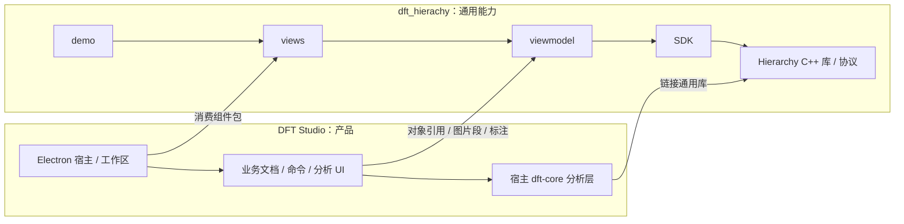

# M5/M6 通用组件与 DFT Studio 客户端深度调研

日期：2026-10-12。执行者：Agent D。任务：D-M56-01。

本报告是源码证据、实验结果和建议，**不替代 [DESIGN](../DESIGN.md)，不表示公共契约已经采纳或测试已经冻结**。领取与正式评审意见见 [REVIEW_LOG](../REVIEW_LOG.md)。

## 1. 可以据此行动的结论

1. **按两类职责分仓可行。** `dft_hierachy` 交付通用 C++ 内核、权威 Schema、SDK、viewmodel/views 和 demo；正式 Studio 组织 Electron 宿主、业务工作区、任务/命令、工程文档和发布。四个现有骨架包已在独立目录编译成 tarball，由仓库外消费者离线安装并导入；没有复制组件源代码到消费者。实验只证明包消费机制，尚未验证实际 SDK/UI。
2. **继续现有 React + 自有视图模型 + SVG/ELK 方向。** HAL、Theia、Sprotty 的可借鉴点分别是局部图上下文、面板生命周期、投影与布局分层。源码证据没有提供必须更换整个技术栈的理由。Theia 是工作台框架参考；HAL/Kactus2 的 Qt 实现不能直接作为 React 组件使用。
3. **M5/M6 前应先收敛几处组件契约。** 重点是选择对象种类与作用域、可定位的树行和源码坐标、图片段的所属来源及替换/移除、异步布局完成时的代次校验、组件销毁与 Electron 接入。多数是 B-13 已登记范围的具体化；图片段更新的反例单列 D-03。
4. **完整规划编辑属于 Studio。** Genconn/Specgen 文档、Scan Plan、MBIST 控制器分组各有修改与生成语义。通用图可显示规划图元、输出交互意图；文档事务、业务校验、编辑撤销重做和写文件由产品层负责。导航历史与编辑历史分别建模。
5. **先做能接入的组件，再组装工作台。** M5 demo 使用真实 SDK 完成浏览、搜索和源码定位；M6 增加追踪与外部片段接入。完整 DRC/Scan/MBIST 后端及旧工程迁移继续按 DESIGN §7 的独立集成顺序推进。

## 2. 基线与证据等级

- 新工程固定起点：分支 `m3`，提交 `2b25f0fab69653a0426e2a74b09b178503add3ba`；DESIGN SHA-256 `28916edcb2a14725108af2120ef9ada95e1cd26a10608c91562d3bd114163874`。
- 起点前端四包只有版本常量，`web/apps/demo` 尚不存在。§5.6 是 M4 细化契约，§6.1 的旧 Transport 草图不能覆盖它。M4 运行时与 UI 未交付这一事实不由本报告改变。
- 收尾已看到 A 正在实现 M4 生成器/客户端及 Node 传输，并追加首轮自测记录。本报告的骨架包实验始终固定在上述提交；“仅版本常量”“缺 Node 入口”等观察不适用于 A 正在写入的新代码，也不作为新实现缺陷或验收结论。
- 旧工程：读取 `dft_planner/dft-suite/src`、`electron` 及 `dft-core/dft-core/hdl-core/protocol/NdjsonServer.cpp`；旧文件按实际字节和 mtime 取证，不能用旧仓库 HEAD 表示带未提交内容的全部现状。
- 证据分为：**源码观察**（固定版本调用链）、**实验观察**（实际命令与结果）、**建议**（依据前两者推导）、**待验证**（需要实际组件或 GUI）。
- 本轮没有运行 HAL/Theia/Kactus2 桌面程序，没有操作 Verdi/Tessent 的授权客户端，没有测量 GUI 帧率、大图性能或内存。商业产品只引用官方公开说明；不会从截图推断内部线程或仓库结构。
- 全部输入清单、SHA、mtime、命令输出及实验结果见 [机器证据](m5-m6-client-evidence.json)。

## 3. 旧工作区：从页面追到后端和文档

以下路径均属于**只读旧工程**。表中的“新位置”是职责建议，不是本轮迁移实现。

| 工作区 | 实际调用链与状态证据 | 新组件可复用部分 | Studio / 专用后端责任 |
|---|---|---|---|
| Hierarchy | `HierarchyTree.tsx:28` 的搜索调用 `hs.findObjects`；`store.ts:1559` reveal → 展开祖先 → `selectInstance:415` 同步选择并激活属性标签；`:698` 请求源码位置；`:862` 追踪。统一经 `core-bridge/client.ts` → preload → main → daemon | 树分页、查询、选择、属性、源码、图追踪 | 面板打开/激活策略与布局；旧路径到新引用的过渡适配 |
| DFT Stream Planner / genconn | `genconn/store.ts:303` 持有文档、dirty、选择和 zundo；`GeneratePanel.tsx:121` 序列化文档 → `dftGenconn.generateAll`；`:190` 注入；`electron/cli.cjs:16` 启动对应 CLI | 设计对象选择、定位；需要浏览电路时复用通用图 | `.arch` 文档、连线编辑、业务校验、编辑历史、生成/注入任务与产物 |
| DFTSpec Planner / specgen | 与 genconn 共用文档 store；`specgen/Workspace.tsx:260` 按 scope/domain 序列化 → `dftSpecgen.generate` → `dft:specgen:gen` → `specgen gen`；`DftConfigDialog.tsx:113` 读取 Scan Plan、预算和 EDT defaults | 引用实际设计时定位/属性；通用显示能力 | DFT IP 配置、SSN/BSCAN/JTAG1838 编辑、scope/domain、预览及 spec 生成；避免复制一份 Scan Plan |
| Scan Planner | `hierarchy/store.ts:500` 恢复 Scan Plan；`:602` → `scan-budget`，`:631` → `wrapper-cells`，`:617` → `wrapper-cone`；`ScanPlannerTab.tsx:151` 结果投影为图 | 实例选择、wrapper cone 显示、源码定位和标注 | family/coverage/EDT 默认值、分析输入、文档保存、业务规则；C++ `computeScanBudget` 为分析入口 |
| Clock Tree | `ClockResetTab.tsx:124` → `clock-reset-tree`；`:253` 构建结果图；`:269` 重建时试图保留用户追加的追踪图元；`:33` 另有图历史 | 局部图、展开折叠、定位和标注 | SDC/库/约束/OCC 输入、分析结果、业务命令；C++ `db.clockResetTree` |
| DRC | `DrcTab.tsx:359` 读取 shell 规划状态并运行分析；`:386` → `clock-reset-tree`；`:250` 打开违例调试页，`:273` 投影违例图；`:433` 根据规划修订刷新 | 违例对象定位、分析图片段与标注、继续向外追踪 | 规则/结果表、修复建议、规划修改、脚本生成和任务状态；业务判断归专用分析层 |
| SDC Check | `SdcTab.tsx:97` → `hs.sdcLint`，含未保存文本；`NdjsonServer.cpp:1357` 解析请求，`:1406` 调 `sdc::lintFile/lintText` | 源码/对象定位，诊断显示基础能力 | SDC 文档、方言选择、约束加载及业务诊断；本地文本编辑不改内核快照 |
| DFX IP | `DfxIpTab.tsx:47/99/111` 经 dp-shell 查询/添加/移除规划 IP；`:119` 构建控制电路；还读取/编辑 IP Verilog | 有真实 ref 的定位；规划图元显示 | IP 库、计划对象 ID、控制器与 mux 配置、编辑/导出；不存在的设计对象不能伪造 ObjectRef |
| MBIST Planner | `MbistTab.tsx:86` → `mbist-plan`；`:112` 的手动修改经 dp-shell，`:124/135/149` 添加、移除、重命名控制器后重算；后端 `NdjsonServer.cpp:468` → `db.mbistPlan` | memory 实例定位、属性、结果/规划标注；图显示基础能力 | 库/DEF/功耗参数、控制器分组、步骤与调度、floorplan 和业务编辑；floorplan 是独立产品视图 |
| DFT Config | `DftCfgTab.tsx:48/87` 经 project bridge 读取/保存 YAML；`:31/93` 识别库并触发 memory-map/read_dfx_ip | 通用错误提示、定位入口 | 配置文档、库发现、保存及业务初始化；不进入层级树组件 |

主要入口：[TopBar](../../../dft_planner/dft-suite/src/shell/TopBar.tsx)、[App](../../../dft_planner/dft-suite/src/shell/App.tsx)、[typed bridge](../../../dft_planner/dft-suite/src/core-bridge/client.ts)、[Electron main](../../../dft_planner/dft-suite/electron/main.cjs)、[daemon](../../../dft_planner/dft-suite/electron/daemon.cjs)、[C++ 请求分派](../../../dft_planner/dft-core/dft-core/hdl-core/protocol/NdjsonServer.cpp)。

### 共享状态中需要保留的需求

- **打开顺序有产品含义。** `store/design.ts:38–106` 在发布 ready 前回放规划、识别库并预热 memory-map。建议 Studio 分开发布“内核设计可浏览”与“某项业务已准备好”的状态；业务准备任务及其错误不藏进 TreeModel/HierClient。这里是迁移建议，不改当前 M4 握手定义。[源码](../../../dft_planner/dft-suite/src/store/design.ts)
- **界面切换应保留本次会话中的工作。** 旧 Clock 页面保留展开状态、图历史及用户额外追踪；重建代码为避免丢图而手动比较旧 base 与当前图。新 GraphSession 应按图文档持有这些状态，React 面板挂载不应隐式重新创建全部数据。关闭文档或设计时显式释放；跨启动保存另属产品层。[源码](../../../dft_planner/dft-suite/src/hierarchy/ClockResetTab.tsx)
- **规划修订独立于设计快照。** `core-bridge/client.ts:105` 上报 `planRev`，`planRev.ts:17` 把它交给 store，DRC 按变化刷新。MBIST 的 `shell:113` 又直接使用 bridge。这些现存不同入口说明新产品需要一个统一业务命令/事件路径。建议结果标识至少关联设计会话、分析输入修订、任务 ID；重命名/删计划对象不需要伪造新 RTL 快照。[bridge seam](../../../dft_planner/dft-suite/src/core-bridge/planRev.ts)、[MBIST](../../../dft_planner/dft-suite/src/hierarchy/MbistTab.tsx)
- **工程文档与查询缓存分开。** `.dftproj` v1 保存 filelist、top 及各文档引用；ScanPlanDoc 还可保存带时间戳的分析结果。产品迁移须定义结果是否仍适用于当前输入，不能凭时间戳当作有效性证明。当前 SDK complete 缓存规则仍按 DESIGN §5.6，不承接工程持久化。[工程格式](../../../dft_planner/dft-suite/src/store/projectFile.ts)、[ScanPlanDoc:451](../../../dft_planner/dft-suite/src/hierarchy/core/scanplan.ts)

## 4. 对标源码比较：采用什么、验证到了哪里

### HAL：一个选择通道，多份局部图上下文

固定提交 `acc899e297ed3866ad7da432ab0403c3d8d62d1c`。

- `GraphWidget` 处理导航时将目标加入 context，并通过 `SelectionRelay` 更新模块/门选择及引脚 subfocus，最后将目标滚动到可见区域；属性区订阅同一个 selectionChanged。[导航链](https://github.com/emsec/hal/blob/acc899e297ed3866ad7da432ab0403c3d8d62d1c/plugins/gui/src/graph_widget/graph_widget.cpp#L422)、[选择联动](https://github.com/emsec/hal/blob/acc899e297ed3866ad7da432ab0403c3d8d62d1c/plugins/gui/src/selection_details_widget/selection_details_widget.cpp#L289)
- `GraphContext` 有 add/remove/clear 与 beginChange/endChange；批量变更完成后再更新布局和 shading；update 保存 viewport。它处理的是一份视图上下文的成员，不等同于修改全部设计事实。[context](https://github.com/emsec/hal/blob/acc899e297ed3866ad7da432ab0403c3d8d62d1c/plugins/gui/src/graph_widget/contexts/graph_context.cpp#L75)
- **采用建议：** 一份设计会话共享语义选择；不同图文档分别持有图成员、展开、viewport 和布局代次。属性区可跟随选择，固定结果页可保留自己的查询对象。不要照搬全局单例：我们的快照重开与面板销毁要有明确作用域。
- **证据限制：** 已追源码链，未运行 Qt GUI；未据此声称支持我们的 RTL 位段、side 或取消语义。

### Theia：宿主创建面板，组件提供内容

通过官方 GitHub API 固定到 `29045502ffe2bd1ecd5c655b40f37f0d0bc0c4ad`（2026-10-09），下载五个相关源文件到独立临时目录。

- `WidgetManager.getOrCreateWidget` 用 factoryId/options 组成稳定键，合并正在创建的 Promise，创建完成后缓存，disposed 时移除，失败路径也释放 widget。[源码](https://github.com/eclipse-theia/theia/blob/29045502ffe2bd1ecd5c655b40f37f0d0bc0c4ad/packages/core/src/browser/widget-manager.ts#L237)
- `AbstractViewContribution.openView` 取得 widget 后交给 shell 安排位置，再区分 activate 与 reveal；`ApplicationShell.closeWidget` 处理可保存文档的关闭路径。[打开](https://github.com/eclipse-theia/theia/blob/29045502ffe2bd1ecd5c655b40f37f0d0bc0c4ad/packages/core/src/browser/shell/view-contribution.ts#L103)、[关闭](https://github.com/eclipse-theia/theia/blob/29045502ffe2bd1ecd5c655b40f37f0d0bc0c4ad/packages/core/src/browser/shell/application-shell.ts#L1757)
- `SelectionService` 是通用 Object 事件通道，没有我们的对象种类、位段、side、快照及历史规则。[源码](https://github.com/eclipse-theia/theia/blob/29045502ffe2bd1ecd5c655b40f37f0d0bc0c4ad/packages/core/src/common/selection-service.ts#L28)
- **采用建议：** Studio 维护工作区/面板注册、唯一实例和激活策略；组件接受模型及宿主回调。共享模块按平台分入口。M5 demo 先用固定布局；本轮没有证据要求直接引入整个 Theia。官方文档支持应用由功能包组合及 browser/node 平台隔离，具体依赖版本以项目锁文件为准。[应用组合](https://theia-ide.org/docs/composing_applications/)、[平台边界](https://theia-ide.org/docs/architecture/)

### Sprotty 与 ELK：事实、绘图模型和布局结果分别管理

Sprotty 固定 `21b80fc2c852411261a692c834d2a4390ba7f2df`；ELK JS 固定 `722f1a3f63016e64f534a8b445283d4d31a88d0e`。

- Sprotty 的 ELK 适配先把 SGraph 转成 ELK graph，计算后把几何结果映射回图模型；不是让布局引擎判断电气连接。[转换链](https://github.com/eclipse-sprotty/sprotty/blob/21b80fc2c852411261a692c834d2a4390ba7f2df/packages/sprotty-elk/src/elk-layout.ts#L56)
- DiagramServer 对 bounds 响应检查 model revision；所读 `doSubmitModel` 在 await layout 前有 revision guard，函数片段在 await 后没有再次检查。本轮未验证完整调度链，**不将这个局部观察报告成 Sprotty 产品缺陷**；它提醒我们 A18 的保证必须用自己的发布时序测试证明。[源码](https://github.com/eclipse-sprotty/sprotty/blob/21b80fc2c852411261a692c834d2a4390ba7f2df/packages/sprotty-protocol/src/diagram-server.ts#L201)
- ELK JS 的请求 ID 关联响应；`terminateWorker` 只转调 Worker terminate，PromisedWorker 的 terminate 不清 resolver 表或 reject pending Promise。[API](https://github.com/kieler/elkjs/blob/722f1a3f63016e64f534a8b445283d4d31a88d0e/src/js/elk-api.js#L65)
- **实验观察：** 调用未经修改的上游 JS API，以受控 worker 传输先回复新请求、再回复旧请求，两者都正常 resolve；terminate 后未回复请求的 resolver 仍保留。未运行真正布局计算或浏览器 Worker，不能把它计为 M6 取消测试。
- **采用建议：** LayoutService 自己拥有任务结算、超时、销毁、Worker 重建与最终发布校验；至少校验图会话、图修订及布局任务身份。超时后保留可查询的语义图，明确旧画面/失败状态；避免将旧坐标错误套到新图。遵循现有 A18/B-13，不再假设 Promise 就代表离开 UI 线程。
- 旧 `schematic/elkLayout.ts:1–10` 明确使用主线程 bundle；它是旧行为证据，不能直接满足 DESIGN 的 Worker 要求。[旧布局入口](../../../dft_planner/dft-suite/src/hierarchy/schematic/elkLayout.ts)

### d3-hwschematic：保留渲染边到原始网络的映射

固定 `0664665d87d7fe8575a812714b765a81de1affbf`。

`hyperEdgesToEdges` 把多端网络展开成绘图边，派生边通过 hwMeta.parent 指回原网络；点击/悬浮按该网络 ID 联动高亮。它还原地修改一对一输入对象。[投影](https://github.com/Nic30/d3-hwschematic/blob/0664665d87d7fe8575a812714b765a81de1affbf/src/dataPrepare.js#L2)、[高亮](https://github.com/Nic30/d3-hwschematic/blob/0664665d87d7fe8575a812714b765a81de1affbf/src/d3-hwschematic.js#L235)

**实验观察：** 两源两目标输入得到四条绘图边，共同指回原网络；一源一目标输入的 sources/targets 被改成 source/target。建议借鉴反向映射，输入必须是独立视图投影。不能用这类笛卡尔积转换推导我们的 RTL 依赖，或以 net 名代替 occurrence/fact/位段/side 的身份。折叠后的每条显示边应能回溯全部原始关系。

### react-arborist：借鉴键盘行为，保留远端分页模型

固定 `d74c4ec696ba98c1a4e981075f6d60cdff3e290b`。

`createRoot` 从 props.data 递归构造 NodeApi，createList 按已加载树展开/过滤；默认容器实现 tree ARIA 和方向键、Home/End 等行为。[建树](https://github.com/jameskerr/react-arborist/blob/d74c4ec696ba98c1a4e981075f6d60cdff3e290b/modules/react-arborist/src/data/create-root.ts#L6)、[可见行](https://github.com/jameskerr/react-arborist/blob/d74c4ec696ba98c1a4e981075f6d60cdff3e290b/modules/react-arborist/src/data/create-list.ts#L13)、[交互](https://github.com/jameskerr/react-arborist/blob/d74c4ec696ba98c1a4e981075f6d60cdff3e290b/modules/react-arborist/src/components/default-container.tsx#L20)

这支持继续自有 TreeModel + 已选虚拟列表：全设计搜索、祖先定位和分页来自 Core；虚拟列表负责可见行。源码没有证明 react-arborist 完全不能外接懒加载，只说明接入这些契约仍需要我们自己的适配。建议借鉴焦点/键盘行为，不恢复实例重命名或拖动语义。

### Kactus2：业务编辑必须同时更新文档和视图

固定 `342bc30c2947afe0e2a479f75fed9449102f71a4`。

`AdHocConnectionAddCommand.undo/redo` 同时维护 scene 中的连接、Design 中的 connection/route 和端点连接状态；PortMapValidator 另外核查端口类型、方向和范围。[编辑命令](https://github.com/kactus2/kactus2dev/blob/342bc30c2947afe0e2a479f75fed9449102f71a4/editors/HWDesign/undoCommands/AdHocConnectionAddCommand.cpp#L49)、[校验](https://github.com/kactus2/kactus2dev/blob/342bc30c2947afe0e2a479f75fed9449102f71a4/IPXACTmodels/Component/validators/PortMapValidator.cpp#L112)

**采用建议：** Studio 的规划修改先形成文档/后端命令，再投影到图；编辑撤销恢复业务数据及其视图，不能仅删除一条 SVG 线。M6 的 `origin: plan` 只提供显示接入，不足以承担规划事务。此处借鉴职责划分，未复制或引入 Kactus2 代码（所读根 LICENSE 为 GPL v2）。

### 商业产品：只支持用户流程层面的比较

- Verdi 官方资料展示源码、原理图等联动工作区域，并列出停靠、多源码窗口、命令搜索等能力。适合支持“同一对象在多个视图定位”的产品方向；无法据此判断其内部组件分包、状态管理或渲染技术。[官方资料，第 3 页](https://www.synopsys.com/content/dam/synopsys/verification/datasheets/verdi-ds.pdf)
- Siemens 官方 Tessent IJTAG Visualizer 介绍 ICL 原理图/IJTAG 网络视图，并说明该能力不再要求 HDL 描述。对我们的启示是业务图元可能来自不同领域模型，不应强迫所有计划节点拥有 RTL ObjectRef。[官方说明](https://resources.sw.siemens.com/en-US/video-tessent-visualizer-new-ijtag-visualization-and-debug/)

本轮未观看完整演示视频、未操作授权软件，也未把这些公开能力列入 M5/M6 必做范围。

## 5. 公共接口需要收敛的场景

### D-03：图片段缺少来源所有权和替换/移除语义

针对 DESIGN §6.2、§7.2。P2，待回复；应在 M6 相应单元实现前收敛，不影响 M4 的已批准单元。

**反例：** 用户图已有追踪片段 U。Clock 分析 A 第一次返回 `{x,y}`，第二次返回 `{x,z}`；同时 DRC 分析 B 也显示 x。当前示意接口只有 `addFragment(fragment)`，图元 origin 只有 design/analysis/plan，fragment 没有来源实例/修订/移除操作。继续 add 不能表达 y 已失效；整体重建又无法从接口保证保留 U、B 和用户布局。`GraphSource.id` 尚未与片段归属建立契约。

旧 Clock `:269–299` 正在以 base/extra 比较补这个需求；HAL 的局部 context 具有显式 add/remove/批量更新。新图应把这个责任定义一次。

**建议语义（方法名交 A 决定）：**

- 每份来源实例拥有自己的 fragment 集合；允许整份替换、移除及幂等释放。
- design 节点可按规范 ref/fact 身份共享，但保留来源成员关系；撤销 A 不应删除仍被 U/B 使用的 x。
- 外部 plan/analysis 图元有来源命名空间；两家来源都叫 `node1` 不能相互覆盖，标签变更不改变对象身份。
- 更新携带图会话及来源修订；A 的旧结果晚到不能覆盖新版。来源撤销时取消/忽略在途回调。
- 修改图内容、图投影、annotation 和布局任务的发布次序明确；数据不存在或被移除时选中项如何退回也要定义。

**B 可用的判别场景：** A1→A2 替换后仅剩 x/z；撤销 A 后 U/B 的 x 仍在；两来源同名节点不碰撞；撤销后旧回调不复活片段；折叠/展开不丢 U；同一快照下来源修订变化使旧布局结果失效。

### B-13 的具体补充输入（不重复新增问题编号）

| 接入点 | 需要 A 明确的行为 | 对应验证输入 |
|---|---|---|
| 选择与导航 | `Slice[]` 如何表达实例、DefRef、无位宽对象、端口 side、源码候选；规划对象选择在宿主怎样关联可选设计引用。选择作用域、去重、反馈抑制和 back/forward 分叉 | 同一端口 inside/outside；同定义多个实例；纯计划对象；树→图→源码一次用户动作只记录一次导航 |
| 树定位 | RowId/TreeRow、未加载/加载中/失败/后续页行、分页 reveal、设为目标展开状态、取消后的展示和焦点 | 目标在第二页/多级祖先；快速展开→折叠；隐藏 generate scope；escaped 标识符。使用 Core ancestors/refs，不能延用旧 `split('.')` 推断路径 |
| 源码显示 | 使用既有 FileRef、SourceRead 和 SourceSpan；把 UTF-8 字节列转换为前端位置；处理 matchesSnapshot=false、not_found、多候选和取消 | 多字节字符、tab、CRLF、include/宏调用、磁盘已修改；禁止宿主另走旧任意路径 readSource 来绕过快照提示 |
| 图结果和标注 | GraphPort/LaidOutGraph、层级归属、边到事实/位段/side 的反向映射、部分结果与保守精度的可见状态、多个 annotation 层的冲突/清理 | 同网名不同实例；多驱动不同角色；同事实不同位段；partial 空结果；两标注层叠加后撤销一层 |
| 布局与释放 | LayoutService 的超时、取消/失败结算、Worker 所有权、重试、最终发布校验；Tree/Selection/Graph/Source 模型订阅和 dispose 契约 | L1 挂起→图改为 R2→L2 完成→L1 晚到；关闭后回调；超时后新 Worker 成功；同一会话反复打开/关闭面板 |
| Electron 挂载 | Node 子进程适配、main/preload/renderer 连接绑定与订阅/关闭顺序；公开包入口与 demo 的实际挂载方式 | hello 先于 renderer 订阅；关闭一个面板不关闭整份设计；关闭设计结算全部 pending；重开不能复用旧 Transport/HierClient |

**所有权建议：** SDK 拥有请求关联、complete 缓存、合并请求与独立取消；viewmodel 拥有树/选择/图/布局状态；宿主持有设计会话和面板实例并决定何时销毁；Studio 的业务服务持有规划文档、修订和分析任务。宿主打开源码/激活标签通过显式回调，组件不 import 产品 store。

Electron 的具体通信方案仍需 A 按 §5.6 细化：主入口保持无 Node/Electron 依赖；可共用的 Electron 连接适配应从当前仓库的隔离入口复用。demo 与 Studio 不各写一套首帧缓存、关闭和取消转发。仅增加一个可选入口还是独立适配包由 A 提交具体方案；本报告不直接新增 API。

## 6. 三条代表流程与工作区草图

以下是建议布局，非已实现 UI。M5/M6 demo 仅包含可由当前内核与组件完成的部分。

### 流程一：搜索实例 → 属性/源码 → 位段追踪

```text
[打开设计 / 当前快照 / 后退 / 前进 / 任务状态]
[搜索结果与层级树] [源码标签 | 原理图标签] [属性：端口/参数/位段]
                  [结果不完整原因 / 布局状态 / 重试]
```

1. search 得到类型化命中；实例通过 TreeModel.reveal 加载祖先与目标页。定义命中可先显示定义，涉及实例追踪时列出 instancesOf 候选。
2. 更新共享语义选择，属性刷新；打开源码由宿主安排标签。`obj.source → source.read`，不丢弃 matchesSnapshot 提示。
3. 用户选定位段与端口 side 后发起 trace；图中保留事实身份及 precision/completeness。
4. 反向点击源码时显示全部候选并支持分页；用户确认后定位实例，不默认选第一个。

**M5 验收基础：** 真实 `processor_core` 上搜索/树/属性/源码链。**M6 增量：** 图追踪、图与源码/树联动。不能拿只有假 IPC 的 demo 替代真实链。

### 流程二：DRC/Clock 结果 → 定位与标注 → 返回结果

```text
[设计会话 / 分析输入修订 / 运行·取消 / 结果状态]
[规则/结果列表] [局部电路图 + 用户追加追踪] [源码 | 规则说明 | 修复建议]
[任务输出 / 命令控制台（Studio）]
```

1. Studio 分析任务记录设计会话、输入修订和任务身份。用户从结果表选一项，产品适配器交给通用组件真实对象引用、图片段和标注。
2. GraphSession 维护该结果来源；用户继续追踪的片段有独立归属。切换面板后保留会话内图状态，返回时恢复结果焦点。
3. 规划改变后分析任务更新，仅替换自己来源的结果/标注；晚到的旧结果不能覆盖新结果。
4. 尚未迁移的旧结果路径仅通过 DESIGN §7 的唯一适配点转成 ref；定位失败显示原因。

**M6 可独立验证：** 在真实设计上使用明确标记的测试来源注入片段/标注，检查定位、替换、撤销和继续追踪；这不表示 DRC 算法已迁移。**Studio 后续：** 接真实分析与命令。

### 流程三：Scan/MBIST 规划对象 → 设计引用 → 修改与预览

```text
[当前工程 / 规划文档 / 未保存状态 / 编辑撤销·重做 / 生成任务]
[family/控制器/步骤] [业务表格或规划画布] [业务属性 / 关联实例]
                    [通用原理图/源码定位] [产物预览与诊断]
```

1. 产品文档中选一个 family、控制器或 memory。纯计划对象保持自己的 ID；有设计对应关系时解析为当前快照引用。
2. 树/源码/图用于查看设计依据；planning UI 发出的修改进入产品命令和校验路径，再更新文档与图投影。
3. 生成任务消费明确的文档版本，旧预览晚到不替换当前结果；编辑撤销不改设计事实，也不替代导航后退。
4. 保存、旧文档兼容、分析结果过期标识及 reopen 归产品验收。

**M5/M6 预留能力：** 外部选择/定位、外部图片段、通用交互回调。DFT 编辑事务、floorplan、Tcl/spec 生成不放进 demo。

## 7. 分仓后的消费与发布

建议产品仓库同时容纳 Electron 应用与宿主 `dft-core` 的专用分析模块；通用 Hierarchy C++ 库作为依赖。这样两仓库按领域职责划分，产品的业务后端仍有明确归属。目录名称和迁入时序由正式产品计划确定。



### 已实际验证

固定提交的 `web` 通过 git archive 进入独立临时目录；使用既有 TS 5.9.3 编译器和 Node 24.21.0 自行编译。构建目录用临时工作区链接解析四包；消费者只安装四个生成的 `.tgz`，实际包目录均非 symlink，解析位置均在消费者 `node_modules`。

| 实验 | 实际结果 | 能证明什么 |
|---|---|---|
| 编译四包、逐包 npm pack、消费者离线 install/import | 11 条记录命令全部退出 0；四包各导出值为 2 的版本常量 | 当前分层骨架能作为包消费，独立 Git 仓库不要求复制客户端源码 |
| 消费者 import `@hier/client/node` | 观察到 `ERR_MODULE_NOT_FOUND` | 固定骨架还未交付 M4 Node 入口；不是本轮发现的运行时回归 |
| 消费者解析 `@hier/client/src/index.ts` | 当前可解析，tarball 包含 src 与 tsconfig | 后续需要决定受支持入口并配置 exports/files；不是将所有内部路径承诺成 API |
| D3 源码实验两组 | 多端边保持父网络关联；一对一转换修改输入 | 绘图投影须与事实分开，映射可用于联动 |
| ELK API 受控实验两组 | 新旧响应都可结算；terminate 留有未结算 resolver | A18 需要组件自己的发布/任务生命周期控制 |

初次探索误用系统默认 Node 23.11.0，结果不计支持环境验收；最终可复现脚本明确使用 24.21.0，完整重新构建/打包/安装。未修改 engines。原探索记录留在临时证据目录。

### 交 A 的包交付建议

- 四包由当前仓库发布，Studio 固定版本消费；初期可使用版本化 tarball，之后是否私有 registry 由发布需求决定。保留 lockfile 与组件/Core/Schema 的配套信息；开发联调可用工作区链接，发布验证必须安装产物。
- 定义各公开入口、类型声明、依赖版本范围、样式及 ELK Worker 资源的交付方式。组件引入 React 后再明确 peer dependency 与宿主 React 兼容范围；当前骨架不含 React，不能从本实验推出不会重复装 React。
- SDK 通用入口继续无 Node/Electron 依赖，`@hier/client/node` 按已有契约；可复用的 Electron 适配集中维护，产品提供窗口/进程配置与宿主回调。
- M5 增加真实外部消费者链：安装产物 → 启动固定 Core → 握手 → 打开设计 → 树/属性/源码 → 关闭。M6 再加 Worker 装载、图片段和追踪。现阶段不能冒充这些链已经通过。
- Core 对通用查询的权威性、专用 DFT 规则留在宿主 C++ 分析层的边界保持。产品仓库只增加业务能力，不复制 Schema 或另写同名层级查询规则。

## 8. 分阶段交接与风险验证

| 顺序 | A 的具体下一步 | B 可冻结/验证 | C 重点 |
|---|---|---|---|
| M4 继续 | 沿现有受审/冻结范围完成 SDK；本调研不重新阻塞该链 | 原 M4 集合 | 既有 Schema、握手、生命周期门禁 |
| M5 契约 | 把本报告的选择/树/源码/Electron 接入场景收敛到 DESIGN 与 M5 计划 | B-13、真实 SDK 挂载、同定义多实例、分页与过期回调、UTF-8 坐标 | 所有权、公开入口、无产品 store 依赖 |
| M5 实现 | 通用模型/组件 + 固定布局 demo；形成实际可安装包 | processor_core 真实浏览、搜索、定位；独立消费者 | 数据与错误链、关闭与订阅回收、产物内容 |
| M6 契约/实现 | 回复 D-03；定义图身份/来源/代次、LayoutService 和标注生命周期 | A17/A18/A19 与上述判别输入；图折叠关系保持、取消/失败/重试 | 数据与投影分离、layout 最终发布、source 清理 |
| Studio 组装 | 在产品计划中落下工作区、业务命令、工程文档与迁移；消费同一套包 | 每次业务迁移独立验收，按 §7 验证双后端过渡 | 算法归属、唯一适配点、工程兼容和发布 |

**需要实测的风险，不能从源码阅读宣布通过：**

- 树：目标在后续页时 reveal 的查询数、取消、最后意图与键盘焦点。用可手算分页 fixture 先测正确性，再测 `processor_core`/`openc910`。
- 图：局部扇出、层级折叠、位段及多驱动的图元增长；逐档记录节点/边数、查询耗时、布局耗时和渲染耗时。10 万实例设计不意味着同时绘制 10 万节点。
- 布局：使用真正 Worker 验证 UI 响应、terminate/recreate、超时后 pending 结算及释放；受控 API 实验不能代替这一步。
- 生命周期：面板隐藏、关闭、切设计分别验证；共享选择/图模型存活范围明确，业务任务输出不得串到新设计。
- 资源预算：沿 DESIGN 的 M7 目标与目标机测量再定数值；本轮不编造帧率、时延或内存保证。

## 9. 复现与完成边界

```sh
# 仅调用 ref 中实际 JS API/投影函数；输出明确标记为受控源码实验。
node docs/research/client-research-probes.mjs ref /tmp/client-source-probes.json

# 固定骨架包实验；使用仓库支持的 Node，临时目录路径在结果中输出。
python3 docs/research/client-package-probe.py --node /path/to/supported/node
```

脚本：[源码实验](client-research-probes.mjs)、[包消费实验](client-package-probe.py)。执行前提是只读 ref 固定源文件仍在、web 已有 TS 编译器；命令不安装生产依赖或修改产品。

本轮完成了十工作区入口至 bridge/后端的职责核对、七个开源项目的相关源码链比较、三条流程草图、所有权/接入建议及两类可复现实验。没有完成整套竞品 GUI 实操、真实跨仓库 SDK/UI E2E、DFT 业务迁移或性能验收。后几项需要实际里程碑产物，已交 A/B/C 明确场景；它们不被包装成研究结论中的“已通过”。
