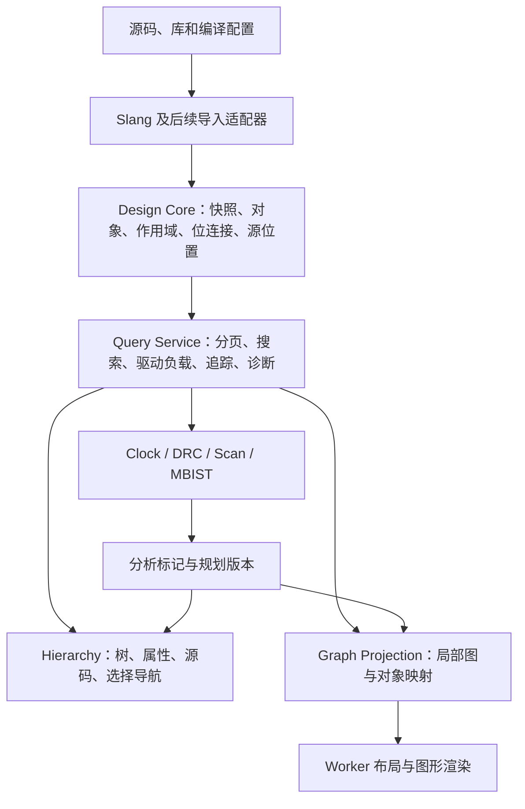

# Hierarchy 重写评估与参考设计

评估日期：2026-10-03。评估对象：`../../dft_planner` 中的 `dft-suite/src/hierarchy`、`core-bridge` 及 `dft-core/dft-core/hdl-core` 相关服务。

本轮交付是现状审计、参考源码下载和重写设计。尚未实现新模块，也没有对旧模块继续打补丁。11 个参考仓库及完整提交 SHA 见 [项目索引](README.md) 和 [版本清单](projects.lock.json)。

## 1. Hierarchy 在本项目中究竟负责什么

Hierarchy 应是“设计对象查询服务 + 设计导航工作区”。它要可靠地回答：某对象是什么、属于哪个实例/作用域、连接到哪里、依据哪段源码、这些信息来自哪个设计版本。其他模块据此开展自己的分析。

| 使用方 | 需要 Hierarchy 提供的基础能力 | 仍由使用方负责的工作 |
|---|---|---|
| 层级树、属性、源码视图 | 实例和定义、参数展开结果、祖先路径、端口/网络/位信息、源码位置、搜索 | 展示、筛选、导航历史 |
| Clock / Reset | 真实网络、驱动与负载、跨层边界、组合依赖、时序单元及引脚角色 | 时钟/复位识别、传播规则、门控和约束解释 |
| DRC / SDC | 相同对象 ID、连接证据、未知/缺库状态、定位与局部图 | 规则判定、约束匹配、问题分类和修复建议 |
| Scan Planner | 寄存器与层级归属、端口角色、连接追踪、规划对象定位 | 分组、链规划、预算、wrapper 和压缩器策略 |
| MBIST | 存储器实例/接口、参数、所属层级、连接与源位置 | memory 分类、算法、控制器和接口规划 |
| 图形工作区 | 可查询的局部子图、边界映射、对象来源、当前设计版本 | 布局、渲染、选择、展开折叠和导出 |

现有 [ClockResetTab.tsx](../../dft_planner/dft-suite/src/hierarchy/ClockResetTab.tsx)、[DrcTab.tsx](../../dft_planner/dft-suite/src/hierarchy/DrcTab.tsx)、[ScanPlannerTab.tsx](../../dft_planner/dft-suite/src/hierarchy/ScanPlannerTab.tsx) 已直接依赖 Hierarchy store 中的根节点、分析状态或 schematic 写入方法。[MbistTab.tsx](../../dft_planner/dft-suite/src/hierarchy/MbistTab.tsx) 也依赖该 store 的错误状态。重写需要将公共设计服务从页面状态中独立出来。

## 2. 当前模块的问题与证据

证据分为两类：**已复现**指已执行最小输入，直接调用当前实现得到错误结果；**代码检查**指从实现发现的缺口或风险，尚未用完整设计和 Electron 界面重放。不能把后者写成已完成的端到端测试。

### 2.1 已复现的三个连接错误

| 编号 | 最小场景与实际结果 | 对后续模块的影响 | 当前代码位置 |
|---|---|---|---|
| R1 | `soc.u_a` 与 `soc.u_b` 是不同实例，逻辑语句来自同一文件同一行；查询 B 的来源，返回 A 的图节点。 | 不同实例的逻辑锥可能串接，源码位置相同被误认为对象相同。 | [schematic.ts:446，findExistingSource](../../dft_planner/dft-suite/src/hierarchy/core/schematic.ts) |
| R2 | A、B 作用域分别有名为 `clk` 的端口；B 的来源被匹配到 A 的端口节点。 | 时钟、复位和常见信号名可能跨作用域混淆。 | [schematic.ts:459，端口来源匹配](../../dft_planner/dft-suite/src/hierarchy/core/schematic.ts) |
| R3 | 图已有 `soc.a.Q → soc.sink.D`；增量加入 `soc.b.Q → soc.sink.D` 后只剩 A 的边。 | 合法多驱动或应由 DRC 检查的多驱动会被显示层隐藏。 | [schematic.ts:174，dropDuplicateDrivers](../../dft_planner/dft-suite/src/hierarchy/core/schematic.ts) |

R1 的匹配条件主要是 `file + line`；R2 使用信号标签；R3 只检查目标引脚是否已有输入边。它们都缺少足以证明“是同一个连接/对象”的身份信息。R3 原意是合并不同追踪方式产生的重复表示，但不能据此假定每个引脚只存在一个真实驱动。

可执行诊断和实际输出见 [audit/README.md](audit/README.md)、[reproduce.ts](audit/reproduce.ts)、[reproduced-findings.json](audit/reproduced-findings.json)。这些用例证明图合并函数存在问题，不代表已定位实际芯片中全部受影响的网络。

### 2.2 数据模型与连接语义缺口

| 编号 | 代码检查发现 | 重写要求 |
|---|---|---|
| S1 | [DesignIR.h:32](../../dft_planner/dft-core/dft-core/hdl-core/ir/DesignIR.h) 主要表示实例/定义；[Netlist.h:14](../../dft_planner/dft-core/dft-core/hdl-core/service/Netlist.h) 的连接是 `instanceId + port + net + tie`，没有明确位映射、端点身份或表达式状态。 | 统一对象模型，显式表示端点、位范围、映射、常量和表达式依赖。 |
| S2 | [SlangHelpers.cpp:164，connNet](../../dft_planner/dft-core/dft-core/hdl-core/service/SlangHelpers.cpp) 剥离 Conversion、ElementSelect、RangeSelect 后只保留底层符号。例如 `bus[7:4]` 和 `bus[3:0]` 都归为 `bus`。 | 保留索引方向、切片、拼接、扩展/截断和逐位映射；显示总线不能替代位语义。 |
| S3 | [Netlist.h:21](../../dft_planner/dft-core/dft-core/hdl-core/service/Netlist.h) 用空 `net` 表达复合连接或未连接；`connTie` 不返回含 X/Z 的常量。该接口难以区分悬空、未知常量、未解析表达式。 | 分开表达 unconnected、constant、expression、unresolved；X/Z 是四态值，不能自动解释为无连接。 |
| S4 | [Netlist.cpp:45](../../dft_planner/dft-core/dft-core/hdl-core/service/Netlist.cpp) 从直接 body members 收集 nets，子连接仅接收 real instance，并跳过非普通 Port；与其他查询的对象覆盖可能不同。 | 明确 generate scope、primitive、blackbox、interface/modport 的覆盖和诊断，使树、搜索、连接使用同一对象集合。 |
| S5 | [DesignDb.cpp:463、598、736](../../dft_planner/dft-core/dft-core/hdl-core/service/DesignDb.cpp) 的若干 trace 入口通过最后一个 `.` 推导父实例。generate 层或转义标识符不能总用字符串截断得到真实父实例。 | 存储 ownerScope/ownerInstance/parent 关系；查询祖先使用关系索引。 |
| S6 | [schematic.ts:465，edgeId](../../dft_planner/dft-suite/src/hierarchy/core/schematic.ts) 只用两端节点/端口生成边 ID；同两端不同位段、网络或投影关系可能冲突。 | 数据连接 ID 与图形边 ID 分离；图边保留 NetId、位映射和来源。 |
| S7 | [PortsTab.tsx:69](../../dft_planner/dft-suite/src/hierarchy/PortsTab.tsx) 以宽度生成 `[width-1:0]`；真实声明可能为 `[15:8]` 或 `[0:7]`。 | 同时保存类型、声明范围、位宽和索引顺序，界面按真实声明显示。 |

现有 Slang 辅助代码已经处理部分 generate、实例数组、blackbox/primitive 等对象。这里的问题是各查询结果的覆盖与语义不统一，不能概括为“现项目完全不支持这些语言结构”。

行为 RTL 还要区分**直接连接**与**逻辑依赖**：`assign y = a & b` 表明 y 依赖 a、b，不能把三个信号当作同一条电气网络。别名归一化也必须遵守 SystemVerilog 的连接语义。

### 2.3 导航、异步状态与可维护性

| 编号 | 代码检查发现 | 重写要求 |
|---|---|---|
| U1 | [HierarchyTree.tsx:62](../../dft_planner/dft-suite/src/hierarchy/HierarchyTree.tsx) 对非 instance 搜索结果使用 parent 导航，parent 为空则使用 id；后端 module 命中返回的是定义 ID 且 parent 为空。 | 搜索结果带类型：定义打开定义/列出实例，端口/网络定位其 owner，实例定位树行。 |
| U2 | 同文件 TreeSearch 清空查询时不推进请求序号；旧请求可能回填结果。 | 查询版本、设计版本和取消机制同时参与结果接收。 |
| U3 | [store.ts:395，toggleExpand](../../dft_planner/dft-suite/src/hierarchy/store.ts) 没有对同一节点请求去重或设计版本校验；异步结束后执行 toggle。 | 展开/折叠是明确目标状态；去重并拒绝过期响应，关闭/重载后不能回写旧节点。 |
| U4 | [store.ts:1559，revealInstance](../../dft_planner/dft-suite/src/hierarchy/store.ts) 通过 `split('.')` 拼祖先；初始载入仅展示第一个候选 top。 | 后端返回 typed ancestor 链，支持多 top 选择、深层定位和未加载祖先。 |
| U5 | [HierarchyTree.tsx:108](../../dft_planner/dft-suite/src/hierarchy/HierarchyTree.tsx) 递归挂载所有已展开节点；未形成完整的 treeitem 键盘导航。 | 行虚拟化、分批加载、键盘/焦点语义；大设计无需一次创建全部 DOM。 |
| U6 | [SchematicTab.tsx:55、65、66](../../dft_planner/dft-suite/src/hierarchy/schematic/SchematicTab.tsx) 的坐标、视口和选择缓存是模块级 Map，只按 seedNodeId 索引。 | 缓存纳入设计快照、图会话及投影版本，并限制容量；同名路径的新设计不复用旧状态。 |
| U7 | 同文件约 771 行布局调用只有 `.then`，没有失败处理；[elkLayout.ts](../../dft_planner/dft-suite/src/hierarchy/schematic/elkLayout.ts) 在主线程运行 ELK。 | 统一捕获转换/布局错误，提供可重试状态；布局放入 Worker，有预算和过期任务处理。 |
| U8 | 页面 store 同时保存设计导航、图形、Clock/DRC/Scan 规划和分析状态，多个模块直接构造/写入 schematic。 | 设计查询、分析结果、规划事务、图会话和界面状态分别管理，通过明确接口关联。 |

现有布局 effect 已有卸载后的 `alive` 检查，不能说完全没有异步保护。主线程布局是否在实际设计上造成卡顿尚未测量；当前只能确认实现没有独立 Worker，且代码注释的设计规模是 5–50 个节点。

## 3. 重写后的数据基础

### 3.1 统一对象模型

| 对象 | 必须保存的信息 |
|---|---|
| DesignSnapshot | 快照 ID、schema 版本、输入文件/内容版本、编译选项、宏/include/library、top 集合、前端版本、诊断与完整性状态 |
| Definition / Specialization | 定义身份、库/文件、源码范围、参数声明；展开后的参数值和类型特化与定义区分 |
| Instance / Scope | 对象 ID、owner scope、父实例、所属定义/特化、实例种类、结构化路径段、generate/数组索引 |
| Port / Pin / Interface | 声明身份、实例中的端点身份、方向、类型、维度、范围、接口/modport 和边界角色 |
| Signal / NetBit / Endpoint | 所属作用域、信号种类、位索引、多驱动/多负载、端点角色、源位置；大型总线可压缩存储但语义必须到位 |
| Binding / Dependency | 两侧有序位映射或表达式、常量四态值、转换规则、条件、连接类别、来源及解析状态 |
| SourceSpan / Provenance | 文件内容版本、起止位置、宏展开/包含来源、所属实例、追踪步骤依据 |
| AnalysisOverlay / PlanRevision | 基于哪个快照、分析或规划版本、引用的对象 ID、结果/计划来源和有效性 |

约束：

1. `ObjectId` 在同一快照内唯一且不可变；不从标签、行号或展示路径反推身份。定义实例化两次就是两个实例对象。
2. 跨编译可提供稳定键与对象重映射，但找不到明确对应时标为失效；不能仅因名字相同就继承旧分析或视图。
3. `ownerScopeId` 与 `ownerInstanceId` 分开，generate scope 可以是 scope 而不是人为伪造的 module。
4. 原始连接事实始终保存。图形合并、总线折叠、别名简化只改变视图，并保留展开回原始关系的映射。
5. 多驱动是事实；是否违反规则由 net 类型、驱动条件和对应 DRC 决定。界面不得静默删除驱动。
6. 空集合只有在查询完整时才能解释为“没有连接”。超时、截断、不支持表达式、缺库必须有独立状态。
7. 行为依赖、直接网络连接、分析推断和规划连接有不同类型，避免不同模块将它们当成同一事实。

### 3.2 公共查询契约

以下是接口职责草案，不是已经实现的 API：

| 接口 | 核心语义 |
|---|---|
| `openDesign / getSnapshot / closeDesign` | 建立与释放快照；报告编译诊断、可用 top 和支持能力 |
| `listRoots / listChildren / getAncestors` | 分页、确定排序、结构化父子关系；返回 children 是否完整 |
| `getObject / listInstancesOfDefinition` | 按有类型身份查询；定义与实例分别导航 |
| `searchObjects` | 按对象种类、作用域、名字/路径、参数或属性筛选；游标分页、取消和截断说明 |
| `getPorts / getSignals / getBindings` | 类型、实际范围、边界角色、逐位连接和表达式来源 |
| `getDrivers / getLoads` | 单个位/位段/整网查询；返回全部已知端点及未知边界，不做显示层去重 |
| `traceCone / findPaths` | fanin/fanout、跨层、时序/blackbox 停止条件、深度/节点/边/时间预算、循环检测 |
| `getSource / resolveSelection` | 实例到定义/语句定位，以及源码到可能多个实例的反向定位 |
| `createGraphView / expandGraphView` | 将查询结果投影为局部图，保留每个图元与真实对象/位段的映射 |

所有响应带 `snapshotId`、`requestId` 和明确的完整性信息。分页用 cursor；追踪使用 `complete / cutoffReason / frontier` 描述尚未探索部分。`frontier` 至少能作为后续新查询入口，不要求所有前端都能原地续算。

只有能从语义得到确定结果的连接才标为精确；动态索引、未解析库、复杂行为依赖需返回具体状态和证据。对全部语言特性的支持不能用一个“解析成功”布尔值代替。

## 4. 界面需要完整到什么程度

| 范围 | 必须具备的能力 |
|---|---|
| 设计会话 | 文件集/宏/包含目录/库/top、编译进度和诊断、取消、重载、设计版本提示 |
| 层级树 | 多 top、generate 和实例数组、懒加载与分页、虚拟化、按定义查看所有实例、键盘导航、展开/折叠、定位和复制路径 |
| 搜索导航 | 全设计有类型搜索、作用域限定、分页、定位未加载实例、面包屑、前进/后退、收藏、清晰的不存在/失效状态 |
| 属性面板 | 实例/定义/参数、端口方向和真实范围、interface/modport、网络驱动负载、blackbox 与缺库原因、源位置 |
| 连接追踪 | 从引脚、内部网络、总线位段开始；fanin/fanout、跨层进入/退出、时序边界、循环、高扇出、条件与停止原因 |
| 局部网表图 | 多端点网络、分支/整网高亮、总线展开、层级展开折叠、保留边界连接、精确点击、框选、缩放、平移、定位、布局重排 |
| 多视图联动 | 树、属性、源码、图和分析结果共享 typed selection；双向定位；多实例对应同一源码时让用户选择实例上下文 |
| 图会话 | 多标签、历史、会话保存、版本校验、用户位置/视口、固定节点、视图导出与包含元信息的查询结果导出 |
| 稳定性 | 请求去重/取消、过期响应拒绝、错误可见且可重试、缓存限额、布局 Worker、预算/截断提示、可复现诊断 |

DFT 规划编辑基于单独的 `PlanRevision`：新增 mux、端口或 IP 的计划连接具有自己的命名空间、事务、校验、撤销重做和导出。规划生效后的设计必须重新导入/建立新快照，才能成为真实设计事实。X6 等编辑器的通用连线操作不能直接决定电气合法性。

仿真动画、时序数值和信号值只有接入相应结果时才显示。Hierarchy 无需自行实现完整仿真器、综合器或 STA 引擎。

## 5. 具体参考哪些项目、哪些功能

所有以下项目均已下载；[README](README.md) 列出了经过路径检查的源码阅读入口和各项目的边界。

| 项目与官方来源 | 优先阅读的实现 | 新模块借鉴的功能 | 使用方式 |
|---|---|---|---|
| [Slang](https://github.com/MikePopoloski/slang) | `InstanceSymbols.h`、`PortSymbols.cpp`、`SelectExpressions.cpp`、`SourceManager.h`、Hierarchy/Port tests | 参数特化、generate 展开、端口表达式、类型/范围、源位置和诊断 | 继续作为语言前端候选，重写统一输出适配层；本轮下载不等于升级现有依赖。 |
| [Yosys](https://github.com/YosysHQ/yosys) | `kernel/rtlil.h`、`kernel/sigtools.h`、`backends/json/json.cc` | SigBit/SigSpec、位向量与常量表达、连接归一化 | 参考位级表示；综合后的结构不能直接冒充原 RTL 层级。 |
| [HAL](https://github.com/emsec/hal) | Netlist/Module/Net/Endpoint、traversal decorator、graph context/navigation、clock tree plugin | 设计数据库分层、局部图、上下游追踪、选择联动、图会话与分析插件 | 作为架构和工作流的主要参考；其门级模型与 Qt UI 需要针对 RTL/网页适配。 |
| [React Arborist](https://github.com/jameskerr/react-arborist) | tree/default-container、tree-api、create-list、selection-slice | 虚拟化、键盘、选中/展开、过滤和滚动定位 | 树组件候选；远程懒加载、全设计搜索和快照处理由适配层完成。 |
| [d3-hwschematic](https://github.com/Nic30/d3-hwschematic) | `d3-hwschematic.js`、`dataPrepare.js`、generic renderer、Yosys adapter | 模块/引脚图、网络选择、层级展开、定制符号、端口顺序 | 图形交互和投影的主要参考；引脚点击追踪、编辑及完整数据库仍需自己实现。 |
| [ELK / elkjs](https://github.com/kieler/elkjs) | `elk-api.js`、Worker API、layered 布局选项 | 有向分层、固定端口、正交布局、层次边和 Worker | 布局引擎优先候选，通过独立适配器使用。 |
| [netlistsvg](https://github.com/nturley/netlistsvg) | YosysModel、FlatModule、elkGraph、drawModule、Port | 从连接模型生成图、总线、符号皮肤、SVG 导出 | 导出和图形投影参考。 |
| [AntV X6](https://github.com/antvis/X6) | node/port/edge、history、selection | 端口事件、选择、编辑命令、撤销和扩展机制 | 需要规划编辑时评估；不要求与 d3 同时引入生产依赖。 |
| [Kactus2](https://github.com/kactus2/kactus2dev) | PortMap/Validator、HWDesignDiagram、undoCommands、HierarchyModel | 总线接口、端口映射、层级设计和修改校验 | DFT/MBIST 接口规划参考。 |
| [DigitalJS](https://github.com/tilk/digitaljs) | `circuit.mjs`、`cells/subcircuit.mjs` | 子电路、端口位宽、信号状态与显示关联 | 后续接入仿真结果时的补充参考。 |
| [Adaptagrams / libavoid](https://github.com/mjwybrow/adaptagrams) | `router.h`、`connector.h`、`hyperedge.h`、示例文档 | 避障正交连线、交互调整、多端点路由 | ELK 无法满足特定交互路由需求时再评估。 |

需要澄清两点：

- d3-hwschematic 对输入图端点所在层的约束，是该库的数据组织约束；不能归结成 ELK 完全不支持跨层连接。ELK layered 的能力和适用选项见 [官方说明](https://eclipse.dev/elk/reference/algorithms/org-eclipse-elk-layered.html)。
- Yosys 的信号位编号、HAL 的对象模型都是参考，不能直接当成跨编译永久有效的对象 ID；新模块仍需定义自己的快照和身份契约。

推荐主线：**Slang 语义适配 + 借鉴 Yosys 的位映射 + 借鉴 HAL 的设计服务/局部图 + 虚拟化层级树 + ELK 布局**。d3-hwschematic 提供浏览交互参考，X6 提供编辑候选。先用同一组包含多驱动、总线切片、跨层与大扇出的网表验证图形适配器，再确定生产画布；无需将全部 11 个项目装进应用。

分享链接中的 [yFiles 示例](https://www.yfiles.com/demos/showcase/logicgates/) 已记录为交互参考，商业 SDK 未下载。[UHDM](https://github.com/chipsalliance/UHDM) 和 [OpenDB](https://openroad.readthedocs.io/en/latest/main/src/odb/README.html) 作为可选导入器/数据库机制资料，本轮未下载。

## 6. 推荐架构与实现顺序

层级树可以直接消费轻量分页结果；无需等待整个设计图形化。分析模块消费同一快照，不依赖 Hierarchy 页面是否打开。图形和选择保留对象身份，但不能回写连接事实。

| 阶段 | 产物 | 进入下一阶段的条件 |
|---|---|---|
| 1. 契约与样例 | schema、对象身份规则、语言覆盖表、公开查询签名、最小 HDL/网表样例和预期连接 | 能无歧义表示 R1–R3 及切片/常量/generate 等场景；未知状态明确。 |
| 2. Design Core | 前端适配、索引、快照生命周期、位映射、诊断、无界面查询工具 | 不借助画布即可检验对象、驱动负载、跨层映射和源码来源。 |
| 3. 导航工作区 | 虚拟化树、搜索、属性、端口/网络、源码、会话和取消 | 同名对象、多 top、深层懒加载、快速切换设计的用例通过。 |
| 4. 局部图 | 投影、Worker 布局、追踪扩展、总线/边界、多视图联动、导出 | 不丢边、不串实例；折叠/展开前后连接查询一致；错误可恢复。 |
| 5. 模块接入 | Clock/DRC/Scan/MBIST 的查询适配和 overlays；规划事务独立 | 相同对象在各模块中的身份、位映射和定位一致；可检测过期分析。 |
| 6. 发布验证 | 实际设计回归、容量/耗时/内存记录、错误恢复、安装/打包与迁移说明 | 必需测试确实执行，保留可复现数据和版本清单，无静默跳过。 |

旧接口可通过边界适配逐步迁移，公共数据契约不能以旧 store 的内部结构为标准。用户已有设计文件和规划数据应通过显式迁移/校验导入；不能假定旧图缓存就是可复用设计数据。

## 7. “完整且稳定”的验收要求

这些是新模块需要实现的验收条件，**不是本轮已经通过的测试**。

| 编号 | 必测场景 | 验收结果 |
|---|---|---|
| A01 | 同一模块实例化两次，逻辑来自同一源码位置 | 实例和语句实例身份不同；追踪各自网络不串接。 |
| A02 | 不同 scope 使用相同 clk/reset/data 名称 | 搜索可区分作用域，连接/选择不按标签合并。 |
| A03 | 真正多驱动、条件三态驱动、增量重复查询 | 保留不同真实驱动，仅相同连接身份去重；DRC 能读取完整信息。 |
| A04 | `[15:8]`、`[0:7]`、单 bit 和多维 packed 类型 | 声明范围、索引方向、位宽与连接映射均正确。 |
| A05 | part-select、indexed part-select、拼接、重复拼接、反序连接 | 输出有序映射，未连接位和部分驱动有明确表示。 |
| A06 | 常量 0/1/X/Z、符号扩展、零扩展、截断 | 保留四态位和值转换，诊断宽度变化。 |
| A07 | 参数化特化、实例数组、嵌套 generate、同名块 | 所属定义/特化、scope、父实例和祖先链正确。 |
| A08 | 转义标识符包含点等字符，多 top | 身份不靠字符串切割；各 top 内外导航正确。 |
| A09 | interface/modport、primitive、缺失库和 blackbox | 已知方向与边界保留；不支持或未知的信息明确诊断，不伪造连接。 |
| A10 | 非 ANSI/复杂端口声明、结构成员与数组索引 | 明确支持矩阵；可静态解析的映射正确，其余结果携带表达式和状态。 |
| A11 | 跨三层端口、内部别名、多扇出 | 边界穿越逐步可解释，原始边与简化视图均可定位。 |
| A12 | 组合环、时序反馈、高扇出、超预算 | 能结束；标明停止原因与未探索边界，不把部分结果称为完整。 |
| A13 | `assign y=a&b`、条件表达式、过程块 | 依赖边与直接连线区分；保留来源、条件及分析精度。 |
| A14 | 开始展开/搜索后关闭或重载设计 | 旧响应、旧错误和旧选择不能污染新快照。 |
| A15 | 连续展开折叠、双击、清空搜索、请求乱序 | 请求去重，最终状态遵循最后用户意图，无幽灵结果。 |
| A16 | 定义/实例/端口/网络各类搜索 | 命中到正确视图；定位未加载路径；分页不会漏掉或重复已有页对象。 |
| A17 | 层级展开折叠、两种追踪顺序、总线展开收起 | 设计连接不变，图投影不丢边；查询结果独立于界面操作顺序。 |
| A18 | 布局异常、Worker 超时/退出、快速切图 | 错误可见、可重试；过期布局不覆盖新视图，数据仍可查询。 |
| A19 | 树/源码/图/Clock/DRC/Scan/MBIST 交叉定位 | 共用对象身份与设计版本；多实例源码映射不猜选。 |
| A20 | 保存会话再导入已变化设计 | 可重映射对象显式恢复，失效对象提示，不套用同名旧缓存。 |
| A21 | 规划连接编辑、撤销、重做、保存和导出 | 事务原子性、端口/位宽校验和版本依赖正确；真实快照不被视图编辑改写。 |
| A22 | 大规模树、密集网络、连续打开关闭多设计 | 记录分页/搜索/布局 P50/P95、内存峰值和释放情况；树 DOM 随可见行增长，任务可取消。 |
| A23 | schema 变化、后端异常、无源码或不可读源码 | 协议版本检查、错误恢复和可理解诊断；不可用能力不会显示假成功。 |
| A24 | 无二进制、缺依赖、测试路径变化 | 发布必需测试明确失败，不能以全 skip 通过验收。 |

性能验证可从 1 万、10 万实例的树数据和 100、500、2000 个可见图节点分档开始，再用用户实际设计调整档位。记录机器、输入 SHA、冷/热缓存和查询预算；这些是建议测试规模，不是目前已达到的容量或时延承诺。不要尝试一次绘制全芯片全部网络。

测试分为语义单元测试、后端查询集成测试、真实浏览器/Electron 操作测试、实际设计回归和性能测试。连接预期从独立的小型 HDL 样例推导；不能只比较同一实现生成的两个中间结构。交叉工具比较仅限语义可比的子集，综合造成的结构变化须先解释。

## 8. 本轮实际验证状态

- 11 个官方参考仓库下载完成，当前磁盘占用约 485 MiB；保留 Git 和许可证，提交固定在清单中；Git 对象连接检查通过。
- 浅克隆未安装依赖、未构建项目。Yosys 子模块尚未初始化，所以不能把该目录描述成可直接运行的完整工具链。
- R1–R3 使用当前前端纯函数已复现；诊断代码仅存于本 `ref/audit` 目录。
- 旧项目 TypeScript 基线未通过：`tests/audit/value_audit.ts` 引用另一台机器上的 `/mnt/c/...` 绝对路径，随后出现类型错误。
- 旧 `test:unit` 脚本从输出中提取 TAP 的 `# pass/# fail`，本机 Node 默认 reporter 输出不匹配，汇总产生 `?`。这不能证明所有真实单元用例都失败。另行执行 `tree-width` 样例得到 2 个用例通过，未完成一次可信的全套基线运行。
- 现有 `tests/e2e/hierarchy.spec.ts` 查找 `../dft-core/build/hdl`，而本目录结构的后端项目在 `../dft-core/dft-core`；缺二进制时测试会 skip。未执行有效的完整 Electron/后端回归，也未测量真实设计性能。

完成重写的判断依据应是：模型能保存事实、查询能给出完整性和证据、视图忠实表达查询结果、下游模块共用相同身份、验收确实执行。仅替换绘图库不能满足这些条件。
